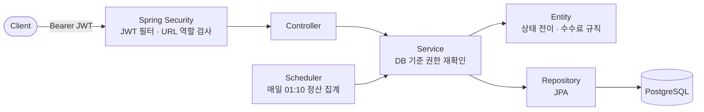

# Spring Delivery Mini

스파르타 단기 심화 온보딩 주차 과제로 시작한 미니 배달 서비스입니다. 주문·결제부터 수수료, 일 정산, 환불·이월까지 구현했습니다.

## 기술 스택
| 구분 | 기술 |
|---|---|
| 언어 · 프레임워크 | Java 21 · Spring Boot 4.1.x |
| 데이터베이스 | PostgreSQL 18 · Flyway |
| 사용 기술 | Spring Web · Spring Data JPA · Spring Security · JWT (JJWT) · Validation · Lombok |
| 테스트 | JUnit 5 · Mockito · Testcontainers (PostgreSQL 18) |
| 빌드 · 도구 | Gradle · Postman |

## 아키텍처



자세한 구성·요청 흐름·패키지 구조는 [프로젝트 구조](docs/architecture.md)를 참고하세요.

## 주요 기능
| 영역 | 내용 |
|---|---|
| 회원 | 회원가입·로그인, BCrypt, JWT 인증, CUSTOMER / OWNER / ADMIN 역할 (ADMIN은 DB에서만 지정) |
| 매장 · 메뉴 | OWNER의 매장 생성(여러 개 가능), 메뉴 등록·수정·삭제(Soft Delete), 소유권은 `Store.isOwnedBy` 한곳에서 판단 |
| 주문 | 같은 매장의 메뉴 여러 개를 한 주문에 담음, 총액은 서버 계산, 주문 당시 메뉴 이름·단가 스냅샷, 상태 전이(결제 → 수락 → 배달완료) |
| 결제 | 서버가 정한 금액으로 결제, 중복 결제 방지(DB UNIQUE), 수수료(기본 5%, 매장별 설정 가능) 스냅샷 저장, 수락 전 취소·배달 후 관리자 환불 |
| 정산 | 배달완료 시각 기준 일 정산, 스케줄러 집계(PENDING) → 관리자 확정 → 지급, 환불은 다음 정산에서 차감하고 부족하면 이월, 사장님 정산 기록 조회 |

## 문서
| 문서 | 내용 |
|---|---|
| [프로젝트 구조](docs/architecture.md) | 아키텍처·주문~정산 흐름 다이어그램, 패키지 구조, 요청 처리 흐름, 테스트 |
| [API 명세](docs/api.md) | API 목록, 주문 상태 흐름, API별 요청·응답·에러 코드 |
| [ERD](docs/erd.md) | ERD 다이어그램, 테이블 간 관계 |
| [데이터베이스](docs/database.md) | Flyway 마이그레이션, 테이블 상세·제약조건, 시간대, 결제 연관관계 |
| [금액 처리 정책](docs/money-policy.md) | 금액 타입, 수수료 계산·반올림, 공통·매장별 수수료율 |
| [정산 기준](docs/settlement-policy.md) | 정산 기간 기준, 집계·확정·지급, 결제 취소·환불과 이월 |
| [질문 · 피드백 요청](docs/review-questions.md) | 과제 리뷰 때 받고 싶은 피드백 |

## 실행 · 테스트
```bash
./gradlew bootRun   # src/main/resources/.env.example을 .env로 복사해 DB 계정 입력
./gradlew test      # Docker 실행 중이어야 함 (로컬 DB·DB 환경변수 불필요)
```
