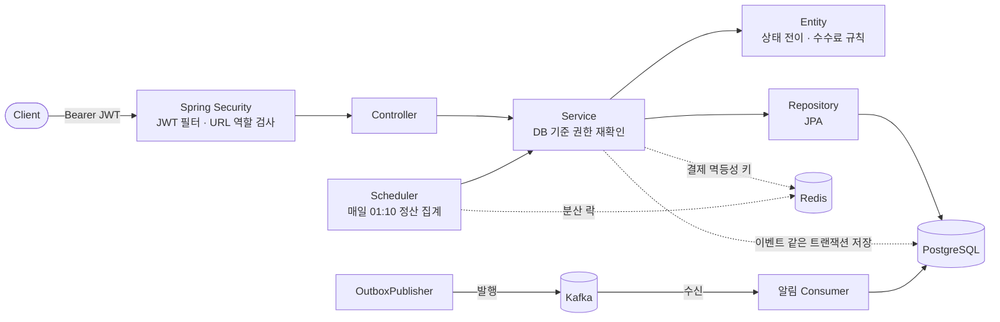

# Spring Delivery Mini

스파르타 단기 심화 온보딩 주차 과제로 시작한 미니 배달 서비스입니다. 주문·결제부터 수수료, 일 정산, 환불·이월, 정산 감사 이력·재집계까지 구현했습니다.

## 기술 스택
| 구분 | 기술 |
|---|---|
| 언어 · 프레임워크 | Java 21 · Spring Boot 4.1.x |
| 데이터베이스 | PostgreSQL 18 · Flyway · Redis 8 (결제 멱등성 키·스케줄러 분산 락) |
| 메시징 | Kafka 4 (KRaft) · Spring Kafka — Transactional Outbox 이벤트 발행·알림 Consumer |
| 사용 기술 | Spring Web · Spring Data JPA · Spring Security · JWT (JJWT) · Validation · Lombok |
| 관측성 · 문서 | Spring Boot Actuator · Micrometer Prometheus · Grafana · springdoc-openapi (Swagger UI) |
| 테스트 | JUnit 5 · Mockito · Awaitility · Testcontainers (PostgreSQL 18 · Redis · Kafka) |
| 빌드 · 도구 | Gradle · Postman |

## 아키텍처



자세한 구성·요청 흐름·패키지 구조는 [프로젝트 구조](docs/architecture.md)를 참고하세요.

## 주요 기능
| 영역 | 내용 |
|---|---|
| 회원 | 회원가입·로그인, BCrypt, JWT 인증(Access 15분) + Refresh Token(HttpOnly 쿠키, DB에 해시만, 재발급마다 교체·재사용 감지 시 로그인 전체 폐기, 로그인 후 30일 절대 만료, 로그아웃), 401 만료·위조 구분(`code`), CUSTOMER / OWNER / ADMIN 역할 (ADMIN은 DB에서만 지정), 내 정보 조회(DB 기준 역할, OWNER는 본인 매장 id 목록), 브라우저 호출용 CORS(허용 출처는 `CORS_ALLOWED_ORIGINS`, 자격 증명은 Refresh Token 쿠키용) |
| 매장 · 메뉴 | OWNER의 매장 생성(여러 개 가능), 메뉴 등록·수정·삭제(Soft Delete), 소유권은 `Store.isOwnedBy` 한곳에서 판단 |
| 주문 | 같은 매장의 메뉴 여러 개를 한 주문에 담음, 총액은 서버 계산, 주문 당시 메뉴 이름·단가 스냅샷, 상태 전이(결제 → 수락 → 배달완료), 목록은 페이지 단위(`?page=`) + 주문 목록 keyset(`?afterId=`, 뒤쪽 페이지도 응답 시간 일정 — 점주 마지막 페이지 426ms → 17.6ms), 주문 단건 조회(결제 정보 포함, 고객 본인·점주 본인 매장) |
| 결제 | 서버가 정한 금액으로 결제, 중복 결제 방지(DB UNIQUE), `Idempotency-Key`로 재시도 시 처음 응답 재전송(Redis + 결제와 같은 트랜잭션의 DB 기록 — Redis 기록이 사라지거나 장애여도 재전송, 같은 키 다른 요청 422·새 결제는 Redis 장애 시 503), 수수료(기본 5%, 매장별 설정 가능) 스냅샷 저장, 수락 전 취소·배달 후 관리자 환불, 본인 결제 단건 조회(현재 상태)·내 결제 목록(페이지 단위) |
| 정산 | 배달완료 시각 기준 일 정산, 스케줄러 집계(PENDING) → 관리자 확정 → 지급, 환불은 다음 정산에서 차감하고 부족하면 이월, 사장님 정산 기록 조회 |
| 이벤트 · 알림 | 결제 완료·환불·배달 완료 이벤트를 업무 데이터와 같은 트랜잭션에 저장(Transactional Outbox) → Kafka 발행(실패 시 지수 백오프 재시도, 한도 초과 FAILED), Consumer가 알림 기록 저장(`eventId` 기준 멱등성, 처리 실패는 재시도 후 DLT) → 발송기가 발송(재시도·FAILED), 내 알림 조회·읽음 처리·안 읽은 개수. FAILED 이벤트 관리자 재발행, 같은 주문 발행 순서 유지, 보관 기간 정리, 메트릭·알림 규칙. Kafka 장애여도 결제 등은 그대로 성공 |
| 정산 운영 | 확정·지급 처리자와 시각을 감사 이력으로 기록(처리자는 인증 정보 기준), 집계 실패를 DB에 기록하고 관리자가 누락·실패분만 재집계(기존 정산은 재계산하지 않음, 스케줄러와 동시 실행에도 매장·날짜당 1건), 여러 인스턴스 중 한 대만 스케줄러 실행(Redis 분산 락, 장애 시 건너뛰고 다음 실행에서 보충) |

## 문제 해결 사례
각 사례는 문제 → 결정 → 검증 순서로 정리했고, 측정 방법·전체 수치는 링크한 문서에 있습니다.

### 1. 주문 목록: 전체 조회 16초 → keyset 페이징 17.6ms (#40, #54)
- **문제**: 목록 API가 전체 행을 한 번에 반환하고 주문 항목을 건마다 조회(N+1). 주문 30만 건에서 점주 주문 목록 평균 15,982ms, 1.1 req/s
- **결정**
  - `Slice`(size + 1건 조회)로 페이징해 매번 실행되는 count 쿼리를 없애고, 주문 항목은 `IN` 일괄 조회로 쿼리 3번 고정
  - 인덱스는 EXPLAIN 근거가 있는 `(user_id, id)`·`(store_id, id)`만 추가. 값을 직접 넣은 EXPLAIN에서는 문제가 안 보여 `PREPARE` + generic plan으로 실제 조건을 재현
  - 남은 병목(점주 전체 주문 OFFSET 뒤쪽 페이지)에만 `?afterId=` keyset 페이징 추가, 기존 `?page=`는 유지
- **검증** (k6, 동시 사용자 20명)

  | 요청 | 개선 전 | 개선 후 |
  |---|---|---|
  | 점주 주문 목록 (전체 → 첫 페이지) | 15,982ms · 1.1 req/s | 19.0ms · 1,028 req/s |
  | 고객 주문 목록 (전체 → 첫 페이지) | 1,205ms · 16 req/s | 18.0ms · 1,082 req/s |
  | 점주 마지막 페이지 (OFFSET → keyset) | 426ms · 47 req/s | 17.6ms · 1,111 req/s |

- **한계**: keyset은 임의 페이지 이동 불가, 다른 정렬을 추가하면 `(정렬 컬럼, id)` 복합 조건·인덱스 필요
- 문서: [성능 개선](docs/performance.md) 4·5·9장

### 2. 정산: 확정된 기록을 고치지 않고 환불 차감·이월 (#30, #39)
- **문제**: 배달완료 후 환불이 생기면 이미 만들어진(또는 지급된) 정산과 어긋남. 기존 정산을 수정하면 지급 기록과 감사 근거가 사라짐
- **결정**
  - 정산 기준 시점은 배달완료 시각(일 정산 D+1, Asia/Seoul)
  - 기존 정산 행은 UPDATE하지 않고 상태 전이(PENDING → 확정 → 지급)만 허용. 환불은 이후 처음 집계되는 정산에서 차감하고, 모자라면 다음 정산으로 이월
  - 수수료는 결제 시점에 원 단위 HALF_UP으로 한 번만 반올림, 정산액 = 결제액 − 수수료 → 1원 오차 없음
  - 중복 차감은 매장 행 잠금 + `settlement_refunds.payment_id`·`settlement_carryovers.from_settlement_id` UNIQUE로 이중 방어
  - 확정·지급 처리자와 시각은 감사 이력으로, 집계 실패는 DB에 기록해 관리자가 누락분만 재집계
- **검증**: 회계 항등식 `Σ지급액 = Σ판매 정산액 − Σ환불 정산액 + 미차감 이월분`을 `PaymentRefundIntegrationTest`로 고정, 날짜 역순·동시 집계에서도 총 지급액 동일
- 문서: [정산 기준](docs/settlement-policy.md) 9·10장, [금액 처리 정책](docs/money-policy.md)

### 3. Redis: 보조 수단으로만 쓰는 결제 멱등성·분산 락 (#41)
- **문제**: 클라이언트 재시도로 같은 결제 요청이 두 번 오거나, 여러 인스턴스의 정산 스케줄러가 동시에 실행될 수 있음
- **결정**
  - 최종 방어는 DB 제약(주문당 결제 UNIQUE, 매장·날짜당 정산 UNIQUE). Redis는 응답 재전송과 불필요한 중복 실행을 줄이는 보조 수단
  - `Idempotency-Key` 결제는 같은 키에 처음 응답을 재전송, 같은 키에 다른 요청은 422
  - 멱등성 키를 결제와 같은 트랜잭션에서 DB(`payment_idempotency_keys`)에도 기록 → Redis 기록이 사라져도 재전송
  - Redis 장애 시 데이터를 바꾸는 쪽으로 진행하지 않음: 키 있는 새 결제는 503, 스케줄러는 건너뛰고 다음 실행에서 보충
- **검증**: Testcontainers Redis로 재전송·동시 요청·Redis 장애 테스트 (`PaymentIdempotencyIntegrationTest`, `PaymentIdempotencyRedisFailureTest`, `SettlementSchedulerLockTest`)
- 문서: [프로젝트 구조](docs/architecture.md) Redis 장

### 4. Kafka: Transactional Outbox와 DLT 재처리 (#42, #52)
- **문제**: 업무 트랜잭션 안에서 Kafka로 바로 보내면 롤백된 결제의 이벤트가 나가거나, 커밋 후 전송 실패로 이벤트가 유실됨. Kafka가 느리면 결제도 느려짐
- **결정**
  - 업무 트랜잭션은 `outbox_events`에 INSERT만 (`Propagation.MANDATORY`로 트랜잭션 밖 호출 차단), 발행은 별도 Publisher
  - 여러 인스턴스는 `FOR UPDATE SKIP LOCKED`로 나눠 발행, 실패는 지수 백오프 후 10회 초과 시 FAILED (관리자 재발행 API)
  - 발행은 최소 한 번 → Consumer가 `consumed_events`에 `ON CONFLICT DO NOTHING`으로 멱등 처리
  - 처리 실패는 1초×3회 재시도 후 DLT, 형식 오류는 즉시 DLT. 원인 해결 후 되돌리는 DLT 재처리 CLI(종료 코드 0/1/2)
  - DLT 적재 카운터가 전송 성공 전에 증가해 과다 집계되던 문제를 전송 성공 후 증가로 수정
- **구현 중 발견한 문제**
  - Spring Kafka 4에서 DLT 기본 이름이 `{topic}-dlt`로 바뀌어 다른 토픽으로 감 → 보낼 토픽을 직접 지정
  - Kafka 접속 불가 시 건마다 5초씩 멈춰 행 잠금을 수백 초 쥐고 있음 → 첫 전송 실패 시 그 주기 중단
  - DLT 조회만으로 브로커가 파티션 1개짜리 DLT를 자동 생성 → `allow.auto.create.topics=false`
- **검증**: 실제 Kafka 컨테이너로 원자성·중복 수신·DLT·재처리 테스트. 로컬 수동 검증에서 DB 장애 → DLT 적재 126.6초, 재처리 후 약 70ms 뒤 알림 저장
- 문서: [Kafka Outbox · 알림 이벤트](docs/kafka-outbox.md) 2·3·7장

## 문서
| 문서 | 내용 |
|---|---|
| [프로젝트 구조](docs/architecture.md) | 아키텍처·주문~정산 흐름 다이어그램, 패키지 구조, Redis 키·TTL·장애 시 동작, Kafka·Outbox 보장 범위·장애 시 동작, 요청 처리 흐름, 테스트 |
| [Kafka Outbox · 알림 이벤트](docs/kafka-outbox.md) | Transactional Outbox 도입 배경·설계 결정, 구현 중 발견한 문제, 검증 결과, 후속 과제 (#42) |
| [로컬 확인 가이드](docs/local-verification.md) | Redis·Kafka 동작을 자동 테스트와 로컬 실행으로 확인하는 절차 (멱등성 재전송·장애, Outbox 발행·재발행·DLT, DLT 재처리 CLI, 메트릭), 주문 목록 keyset·prod 프로필·DB 타임아웃 확인 (#54), CORS 확인 (#61) |
| [API 명세](docs/api.md) | API 목록, 주문 상태 흐름, API별 요청·응답·에러 코드 |
| [ERD](docs/erd.md) | ERD 다이어그램, 테이블 간 관계 |
| [데이터베이스](docs/database.md) | Flyway 마이그레이션, 테이블 상세·제약조건, 시간대, 결제 연관관계 |
| [금액 처리 정책](docs/money-policy.md) | 금액 타입, 수수료 계산·반올림, 공통·매장별 수수료율 |
| [정산 기준](docs/settlement-policy.md) | 정산 기간 기준, 집계·확정·지급, 결제 취소·환불과 이월, 감사 이력과 누락·실패분 재집계 |
| [성능 개선](docs/performance.md) | 목록 API 페이지네이션·N+1 제거·인덱스 근거(EXPLAIN), k6 부하 테스트 개선 전후 비교, 점주 주문 keyset 페이징(#54), 주문·결제 쓰기 경로 부하·멱등성 동시 요청·병목 분석(#68) |
| [운영 프로필](docs/operations.md) | prod 프로필 설정 근거, Swagger·Actuator 노출 정책, 필수 환경변수 점검, 커넥션 풀·DB 타임아웃, 검증 (#54), CORS 설정 근거 (#61) |
| [질문 · 피드백 요청](docs/review-questions.md) | 과제 리뷰 때 받고 싶은 피드백 |

## 실행 · 테스트

### 환경변수
루트의 `.env.example`을 `.env`로 복사해 값을 채움 (`.env`는 git 제외). local 프로필과 docker-compose가 같은 파일을 읽음

| 변수 | 필수 | 설명 |
|---|---|---|
| `DB_USERNAME`, `DB_PASSWORD` | O | DB 계정 (docker-compose는 이 값으로 PostgreSQL 계정도 생성) |
| `JWT_SECRET` | O | JWT 서명 키, Base64 인코딩된 256비트 이상 (`openssl rand -base64 32`). 기본값 없음 → 없으면 기동 실패 |
| `DB_URL` | dev·prod | JDBC URL. docker-compose가 자동 지정 |
| `REDIS_HOST` | prod | Redis 주소 (local 기본 `localhost`, compose는 `redis` 자동 지정). prod는 기본값 없음 |
| `MANAGEMENT_PORT` | - | prod의 Actuator 관리 포트 (기본 8081, 외부에 공개하지 않음) |
| `REDIS_PORT` | local | 이 프로젝트 전용 Redis 포트 (`.env.example`: `6380`). local은 `localhost:REDIS_PORT`로 접속하고, compose는 이 포트로 `redis` 컨테이너를 127.0.0.1에 엶 (앱 컨테이너는 `redis:6379`로 접속). 미지정 시 local 기본값은 6379 → 다른 프로젝트 Redis와 섞일 수 있으니 지정 권장. Redis가 없어도 기동되며 `Idempotency-Key` 결제는 503, 정산 스케줄러는 실행을 건너뜀 |
| `KAFKA_PORT` | - | compose가 Kafka를 127.0.0.1에 여는 포트 (기본 9094, local 실행의 기본 접속 주소 `localhost:9094`). 9092는 다른 프로젝트 Kafka와 겹칠 수 있어 사용하지 않음 |
| `CORS_ALLOWED_ORIGINS` | prod | 브라우저에서 API를 호출할 프론트엔드 출처(쉼표 구분, `scheme://host[:port]`). local·dev 기본 `http://localhost:5173,http://localhost:3000`, 와일드카드·경로·끝 슬래시는 기동 실패 — [운영 프로필 7장](docs/operations.md) |
| `KAFKA_BOOTSTRAP_SERVERS` | prod | Kafka 주소 (local 기본 `localhost:9094`, compose는 `kafka:9092` 자동 지정). Kafka가 없어도 기동·업무 처리는 되고 이벤트는 회복 후 발행 |
| `APP_PORT` | - | docker-compose에서 호스트에 여는 포트 (기본 8080) |
| `DB_PORT` | - | docker-compose가 PostgreSQL을 호스트(127.0.0.1)에 여는 포트 (기본 5432) |
| `DB_POOL_SIZE` · `DB_LOCK_TIMEOUT` · `DB_STATEMENT_TIMEOUT` | - | 커넥션 풀 크기(기본 10), 잠금 대기(기본 5s)·문장 실행(기본 30s) 타임아웃 — [운영 프로필 6장](docs/operations.md) |
| `GRAFANA_ADMIN_PASSWORD` | monitoring | Grafana admin 비밀번호. `--profile monitoring`에서 필수 (빈 값·`admin`이면 Grafana만 기동 실패) |

### 프로필
| 프로필 | 용도 | DB | 설정 파일 |
|---|---|---|---|
| `local` (기본) | bootRun·IDE 실행, SQL 로그 출력 | `localhost:5432/delivery` | `application-local.yml` |
| `dev` | docker-compose 실행 | `DB_URL` (compose의 `db` 컨테이너) | `application-dev.yml` |
| `test` | `./gradlew test`에서 자동 활성화, 테스트 전용 JWT 키 | Testcontainers | `src/test/resources/application-test.yml` |
| `prod` | 운영 배포 (`SPRING_PROFILES_ACTIVE=prod`). 접속 정보·비밀 값 환경변수 필수(없으면 기동 실패), Swagger 끔, Actuator는 관리 포트(8081)에 health·prometheus만 — [운영 프로필](docs/operations.md) | `DB_URL` | `application-prod.yml` |
| `dlt-reprocess` | DLT 재처리 CLI (실행 환경 프로필과 함께 켬, HTTP 포트 없음) | 함께 켠 프로필 기준 | `application-dlt-reprocess.yml` |

### 실행
```bash
# 1) Docker Compose — 애플리케이션 + PostgreSQL 18 + Redis + Kafka (http://localhost:8080)
docker compose up --build -d
docker compose down          # 종료 (DB 데이터 유지, 삭제하려면 -v)

# 1-1) 모니터링 포함 — Prometheus(http://localhost:9090) + Grafana(http://localhost:3000, admin / GRAFANA_ADMIN_PASSWORD)
#      .env에 GRAFANA_ADMIN_PASSWORD 필수 (없거나 admin이면 Grafana만 기동 실패, 기본 up에는 영향 없음)
docker compose --profile monitoring up --build -d
#      대시보드: Grafana → Delivery 폴더 → Delivery App (HTTP·DB, Outbox·Kafka, 알림 발송, Redis, 정산 스케줄러), 알림 규칙 상태: http://localhost:9090/alerts

# 2) 직접 실행 (local) — localhost:5432에 delivery DB, localhost:REDIS_PORT(6380)에 Redis가 있어야 함
docker compose up -d redis   # 이 프로젝트 전용 Redis (127.0.0.1:6380)
docker compose up -d kafka   # 이벤트 발행·알림용 Kafka (127.0.0.1:9094) — 없어도 기동되며 이벤트는 쌓였다가 발행
./gradlew bootRun

# 테스트 — Docker 실행 중이어야 함 (로컬 DB·환경변수 불필요)
./gradlew test
```
- compose의 DB는 `127.0.0.1:5432`(`DB_PORT`)로만 열림 — local 실행이 접속하는 주소이고, 같은 네트워크의 다른 기기에서는 접속할 수 없음
- compose의 DB 계정은 `db-data` 볼륨이 처음 생성될 때만 만들어짐 → `.env`의 DB 계정을 바꿨다면 `docker compose down -v`로 볼륨을 지우고 다시 실행
- compose의 Redis는 이 프로젝트 전용 포트 `127.0.0.1:6380`(`REDIS_PORT`) — 6379는 다른 프로젝트 Redis와 겹칠 수 있어 사용하지 않음. AOF + `redis-data` 볼륨으로 재시작해도 멱등성 기록 유지 (`down -v`면 함께 삭제)
- API 문서: local·dev 프로필에서 http://localhost:8080/swagger-ui.html (기본 설정은 비활성)
- 운영 배포는 `SPRING_PROFILES_ACTIVE=prod` — 필수 환경변수·노출 정책은 [운영 프로필](docs/operations.md)
- 헬스체크 `GET /actuator/health`, 메트릭 `GET /actuator/prometheus`(local은 8080, dev는 호스트에 열지 않는 8081 관리 포트)
- 모든 응답에 `X-Trace-Id` 헤더가 붙고, 같은 값이 서버 로그 각 줄(`[traceId]`)과 에러 응답 `traceId`에 들어감
- CI: GitHub Actions(`.github/workflows/ci.yml`)가 main 대상 PR·push마다 `./gradlew build`(전체 테스트 포함) 실행

## 후속 개선 사항
배경과 상세는 [프로젝트 구조](docs/architecture.md)의 Redis·Kafka 장 "후속 개선" 참고

### Redis
- ~~Redis 장애 전용 메트릭 및 알림 체계 추가~~ → `redis.failures` 등 메트릭 + `monitoring/alerts.yml`
- ~~DB 기반 멱등성 기록~~ → `payment_idempotency_keys`(V14)
- ~~결제 단건 조회 API~~ → `GET /api/payments/{id}` (재전송 전 현재 결제 상태 확인, #53)
- ~~정산 분산 락 TTL 실측~~ → 집계 소요 시간 게이지 + TTL 50% 초과 알림
- ~~Redis·Outbox·알림 대시보드, 알림 규칙 발생 확인~~ → Grafana 패널 18개 + 장애 재현으로 규칙 4개 firing 확인 (#67, [로컬 확인 가이드 5장](docs/local-verification.md#5-모니터링--대시보드--알림-규칙-발생-67))
- Redis 고가용성 및 장애 복구 전략 검토

### Kafka
- ~~FAILED 이벤트 재발행~~ → 관리자 재발행 API
- ~~DLT 재처리~~ → CLI(`dlt-reprocess` 프로필, 전체·파티션/오프셋 지정, 진행 위치 기록·분산 락) (#52)
- ~~Outbox 및 Consumer 처리 기록 보관·삭제 정책~~ → `RetentionCleaner`
- ~~발행 대기 건수, 실패 건수, DLT, Consumer lag 모니터링~~ → 메트릭 + 알림 규칙 (Alertmanager 연동은 남음)
- ~~이벤트 순서 보장~~ → 같은 주문의 앞 이벤트가 대기 중이면 뒤 이벤트를 발행하지 않음
- ~~알림 조회 API·발송~~ → `GET /api/notifications`, 발송기(로그) / 실제 이메일·SMS·푸시 채널 연동은 남음

### 성능 · 운영 (#54)
- ~~점주 전체 주문 뒤쪽 페이지 병목~~ → 주문 목록 keyset 페이징(`?afterId=`), 마지막 페이지 평균 426ms → 17.6ms ([성능 개선](docs/performance.md) 9장)
- ~~운영 프로필~~ → `prod` 프로필: 필수 환경변수 점검, Swagger 비활성, Actuator 관리 포트 분리·최소 노출 ([운영 프로필](docs/operations.md))
- ~~DB 대기 상한~~ → 커넥션 풀 10·커넥션 대기 10초·`lock_timeout` 5s·`statement_timeout` 30s, 초과 시 503 ([운영 프로필](docs/operations.md) 6장)
- ~~CORS~~ → 허용 출처는 환경변수로만, prod는 필수 (#61). 실제 브라우저 확인은 프론트엔드 연동 때 ([운영 프로필](docs/operations.md) 7장)
- ~~prod 필수 값 점검 순서~~ → 빈 생성 전(`EnvironmentPostProcessor`) 검사로 바꿔 `DB_URL` 누락 시에도 빠진 변수 목록 전체를 출력 (#61)
- 배포 환경 확정 후: 프록시 헤더·TLS·JVM 옵션, 실제 트래픽 기준 풀 크기·타임아웃 조정
