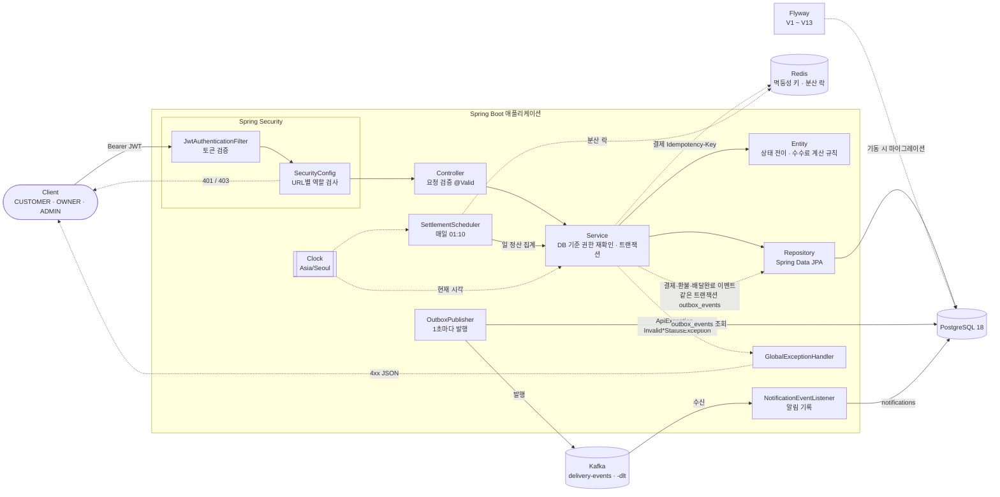
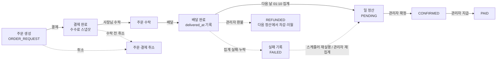
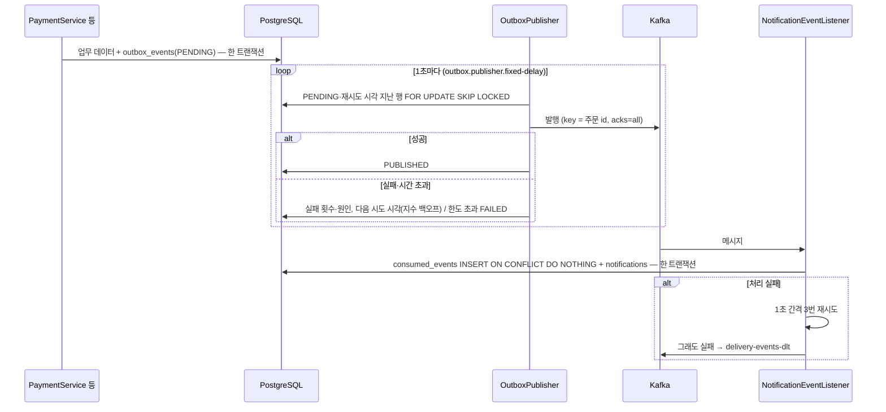
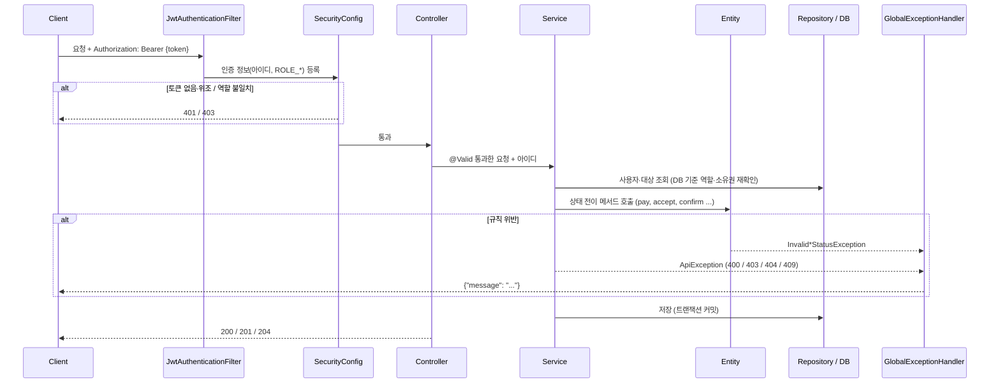

# 프로젝트 구조

[← README](../README.md)

## 아키텍처



- 스키마는 Flyway가 만들고 Hibernate는 `ddl-auto: validate`로 검사만 함 → [데이터베이스](database.md), 테이블 관계는 [ERD](erd.md)
- 권한은 두 겹: `SecurityConfig`가 URL별 역할을, Service가 DB 기준 역할·본인 데이터 여부를 다시 확인 (토큰 발급 후 역할이 바뀌는 경우 대비)
- 현재 시각은 모두 주입된 `Clock`에서 얻음 → 테스트에서 시각을 고정해 정산 날짜 경계 검증

### 주문 → 결제 → 정산 흐름



- 집계·확정·지급마다 처리자와 시각이 상태 변경 이력으로 남음 ([정산 기준 10장](settlement-policy.md#10-감사-이력과-누락실패분-재집계-39))

- 상태별 규칙은 [API · 주문 상태 흐름](api.md#주문-상태-흐름), 정산·환불·이월은 [정산 기준](settlement-policy.md)

## 패키지 구조

```
src/main/java/com/sparta/springdeliverymini
├── SpringDeliveryMiniApplication.java   # 실행 진입점 (JVM 기본 시간대 Asia/Seoul 고정)
├── config
│   ├── SecurityConfig.java              # URL별 접근 권한, 401/403 응답, 비밀번호 암호화(BCrypt)
│   ├── TimeConfig.java                  # 기준 시간대(Asia/Seoul), 현재 시각용 Clock 빈
│   ├── PaymentFeeProperties.java        # 수수료율 설정(payment.fee.rate) 바인딩·검증
│   ├── PaymentIdempotencyProperties.java # 결제 멱등성 기록 TTL(payment.idempotency.*) 바인딩·검증 (#41)
│   ├── SchedulingConfig.java            # @EnableScheduling (settlement.scheduler.enabled로 켜고 끔)
│   ├── OutboxProperties.java            # Outbox 발행·Consumer 재시도 설정(outbox.*) 바인딩·검증, 백오프 계산 (#42)
│   ├── KafkaConfig.java                 # 토픽·DLT 생성, Consumer 오류 처리(재시도 후 DLT, 형식 오류는 즉시 DLT) (#42)
│   ├── NotificationProperties.java      # 알림 발송 설정(notification.dispatcher.*) 바인딩·검증 (V14)
│   ├── RetentionProperties.java         # 보관 기간 정리 설정(retention.*) 바인딩·검증 (V14)
│   ├── BackgroundTaskConfig.java        # 알림 발송·보관 기간 정리 주기 작업 등록, 기본 발송기(로그) 빈 (V14)
│   ├── JpaAuditingConfig.java           # @EnableJpaAuditing, 생성·수정 시각을 Clock 기준으로 기록
│   ├── OpenApiConfig.java               # springdoc 문서 정보, JWT(Bearer) 인증 방식
│   └── ProdProfileGuard.java            # prod 프로필 기동 점검: 필수 환경변수 누락·Swagger 활성 시 기동 실패 (#54)
├── logging
│   └── TraceIdFilter.java               # 요청별 traceId 생성·전달(MDC, X-Trace-Id 헤더), 요청 결과 로그
├── jwt
│   ├── JwtProvider.java                 # JWT 생성·검증
│   └── JwtAuthenticationFilter.java     # 요청마다 토큰을 확인해 인증 정보 등록
├── controller
│   ├── UserController.java              # 회원가입, 로그인
│   ├── StoreController.java             # 매장 생성·조회, 매장별 주문 조회, 매장별 정산 조회, 일 정산 기록 조회
│   ├── AdminSettlementController.java   # 관리자 정산 조회·확정·지급·이력·재집계·실패 기록 (/api/admin/settlements)
│   ├── AdminStoreController.java        # 관리자 매장 수수료율 설정·해제 (/api/admin/stores/{id}/fee-rate)
│   ├── AdminOutboxController.java       # 관리자 Outbox 이벤트 조회·FAILED 재발행 (/api/admin/outbox-events) (V14)
│   ├── NotificationController.java      # 내 알림 목록 (/api/notifications) (V14)
│   ├── MenuController.java              # 메뉴 등록·조회·수정·삭제
│   ├── OrderController.java             # 주문 생성·조회·취소·상태 변경
│   ├── PaymentController.java           # 결제 (선택 헤더 Idempotency-Key, 재전송 시 Idempotent-Replayed), 결제 단건 조회 (#53)
│   └── SliceResponse.java               # 목록 페이지 응답: 본문은 배열, 페이지 정보는 X-Page·X-Size·X-Has-Next 헤더 (#40), 주문 목록은 X-Next-After-Id (#54)
├── service
│   ├── UserService.java
│   ├── StoreService.java                # 매장 생성·조회, 매장 소유권 검증(getOwnedStore)
│   ├── MenuService.java
│   ├── OrderService.java
│   ├── PaymentService.java
│   ├── PaymentIdempotencyService.java   # 결제 멱등성 — Redis 처리 중·완료 기록 + DB 기록으로 재전송, 422·409·503 (#41, V14)
│   ├── SettlementService.java           # 매장별 기간 정산 조회 (소유권·기간 검증, 합산)
│   ├── SettlementAggregationService.java # 일 정산 집계 → PENDING (매장별 트랜잭션, 중복 정산 방지, 실패 기록, 수동 재집계)
│   ├── AdminSettlementService.java      # 관리자 정산 조회·확정·지급 (관리자 확인, 행 잠금, 처리자 이력 기록), 재집계 요청
│   ├── AdminStoreService.java           # 관리자 매장 수수료율 설정·해제 (이후 결제부터 적용)
│   ├── OwnerSettlementService.java      # 사장님 일 정산 기록 목록·상세 (지급액·이월·상태, 차감 내역)
│   ├── AdminOutboxService.java          # 관리자 Outbox 조회·재발행 (FAILED → PENDING, 행 잠금) (V14)
│   └── NotificationService.java         # 이벤트 → 알림 기록, eventId 기준 멱등성(consumed_events) (#42), 내 알림 목록 (V14)
├── event                                # Kafka Transactional Outbox (#42)
│   ├── OutboxEventRecorder.java         # 업무 트랜잭션 안에서 이벤트 저장 (MANDATORY — 업무 데이터와 함께 커밋·롤백)
│   ├── OutboxPublisher.java             # outbox_events → Kafka 발행 (SKIP LOCKED, 실패 시 백오프 재시도, 한도 초과 FAILED)
│   ├── OutboxPublishScheduler.java      # 주기 발행 전용 스레드 (outbox.publisher.enabled로 켜고 끔, 정산 스케줄러와 분리)
│   ├── OutboxMetrics.java               # 발행 대기·FAILED 건수, 가장 오래된 대기 시간 게이지 (V14)
│   ├── NotificationDispatcher.java      # 알림 기록 → 발송 (SKIP LOCKED, 실패 시 재시도, 한도 초과 FAILED) (V14)
│   ├── NotificationSender.java / LoggingNotificationSender.java # 발송 채널 인터페이스 / 기본 구현(로그 출력) (V14)
│   ├── NotificationEventListener.java   # Kafka Consumer — 메시지 해석·검증 후 NotificationService 호출
│   ├── DltReprocessor.java              # DLT → 원래 토픽 재발행 (kafka_dlt-* 헤더 제거, 그룹 오프셋으로 진행 위치 기록) (#52)
│   ├── DltReprocessRunner.java          # DLT 재처리 CLI (dlt-reprocess 프로필, --all / --partition·--offset, 분산 락) (#52)
│   ├── DeliveryEventMessage.java        # 이벤트 본문(payload) — 발생 시점 스냅샷
│   └── InvalidEventMessageException.java # 형식이 잘못된 메시지 → 재시도 없이 DLT
├── scheduler
│   ├── SettlementScheduler.java         # 매일 01:10 최근 N일 정산 자동 집계 (분산 락을 잡은 인스턴스만), 실행 결과·소요 시간 메트릭
│   └── FixedDelayTask.java              # 전용 스레드로 fixed-delay 반복 실행 (알림 발송·보관 기간 정리) (V14)
├── maintenance
│   └── RetentionCleaner.java            # 보관 기간이 지난 발행 완료 이벤트·처리 기록·멱등성 기록 삭제 (V14)
├── lock
│   ├── DistributedLock.java             # 인스턴스 간 실행 락 인터페이스 (#41)
│   ├── RedisDistributedLock.java        # Redis 구현 — SET NX PX 획득, token 확인 후 해제(Lua), 최소 유지 시간
│   └── LockUnavailableException.java    # Redis 장애로 락 상태를 알 수 없음 → 작업 미실행
├── repository
│   ├── UserRepository.java
│   ├── StoreRepository.java
│   ├── MenuRepository.java
│   ├── OrderRepository.java
│   ├── PaymentRepository.java
│   ├── SettlementRepository.java
│   ├── SettlementStatusHistoryRepository.java       # 정산 상태 변경 이력 (처리자 함께 조회)
│   ├── SettlementAggregationFailureRepository.java  # 정산 집계 실패 기록
│   ├── OutboxEventRepository.java       # 발행 대상 조회 (FOR UPDATE SKIP LOCKED) (#42)
│   ├── ConsumedEventRepository.java     # 처리 기록 INSERT ... ON CONFLICT DO NOTHING (#42)
│   └── NotificationRepository.java      # 알림 기록 (#42)
├── entity
│   ├── BaseEntity.java                  # 생성·수정 시각 자동 기록 (@MappedSuperclass)
│   ├── User.java / Role.java            # 회원, 역할(CUSTOMER / OWNER / ADMIN)
│   ├── Store.java                       # 매장 (OWNER 1 : N, 소유권 판단 isOwnedBy)
│   ├── Menu.java                        # 메뉴 (매장에 속함, Soft Delete)
│   ├── Order.java / OrderStatus.java    # 주문, 주문 상태 (항목 추가·총액 계산은 addItem, 배달완료 시각 deliveredAt)
│   ├── OrderItem.java                   # 주문 항목 (메뉴 1종 × 수량, 주문 당시 이름·단가 스냅샷)
│   ├── Payment.java / PaymentMethod.java # 결제, 결제 수단(CARD)
│   ├── PaymentFee.java                  # 수수료·정산액 계산 (원 단위 HALF_UP)
│   ├── SettlementPeriod.java            # 정산 조회 기간 규칙 (반열림 구간, 확정 시각, 최대 31일)
│   ├── SettlementTotals.java            # 정산 합계 계산 (조회·확정 공통)
│   ├── Settlement.java / SettlementStatus.java # 일 정산 기록, 상태(PENDING → CONFIRMED → PAID)
│   ├── SettlementStatusHistory.java     # 정산 상태 변경 이력 — 처리자·시각 (INSERT 전용)
│   ├── SettlementAggregationFailure.java / SettlementAggregationFailureStatus.java # 집계 실패 기록, 상태(FAILED → RESOLVED)
│   ├── OutboxEvent.java / OutboxEventStatus.java / OutboxEventType.java # 발행 대기 이벤트, 상태(PENDING → PUBLISHED / FAILED), 종류 (#42)
│   ├── ConsumedEvent.java               # Consumer가 처리한 이벤트 (eventId PK) (#42)
│   ├── Notification.java / NotificationSendStatus.java # 알림 기록, 발송 상태(PENDING → SENT / FAILED, SKIPPED) (#42, V14)
│   └── PaymentIdempotencyKey.java       # DB 결제 멱등성 기록 — 결제와 같은 트랜잭션에 저장 (V14)
├── dto                                  # 요청(Request) / 응답(Response) 객체, PageQuery(목록 page·size 검증, id 오름차순 고정), KeysetQuery(주문 목록 afterId·size, #54)
└── exception
    ├── ApiException.java                # 상태 코드를 담아 던지는 예외
    ├── InvalidOrderStatusException.java # 허용되지 않는 주문 상태 전이 (Order 엔티티가 던짐 → 409)
    ├── InvalidSettlementStatusException.java # 허용되지 않는 정산 상태 전이 (Settlement 엔티티가 던짐 → 409)
    ├── InvalidOutboxEventStatusException.java # 허용되지 않는 Outbox 상태 전이 (FAILED가 아닌 이벤트 재발행 → 409)
    ├── ApiErrorResponse.java            # 공통 에러 응답 {status, error, message, path, traceId}
    └── GlobalExceptionHandler.java      # 예외를 ApiErrorResponse로 변환, 4xx WARN / 5xx ERROR(스택 트레이스) 로그

src/main/resources
├── application.yml                      # 공통 설정 (기본 프로필 local, DB 계정·JWT 키는 환경변수, 커넥션 풀·DB 타임아웃, Redis 주소·타임아웃, 멱등성 TTL·스케줄러 락, Kafka 주소·프로듀서 타임아웃, Outbox 발행·재시도, 로그 traceId, Actuator health만(Redis 헬스체크 제외)·springdoc 비활성)
├── application-local.yml                # local: localhost DB, 루트 .env 읽기, SQL 로그, prometheus·Swagger UI 노출
├── application-dev.yml                  # dev: docker-compose 실행 (DB_URL, REDIS_HOST, KAFKA_BOOTSTRAP_SERVERS), Actuator 관리 포트 8081, Swagger UI
├── application-dlt-reprocess.yml        # dlt-reprocess: DLT 재처리 CLI — HTTP 포트·Consumer·주기 작업 끔 (#52)
├── application-prod.yml                 # prod: 운영 — 접속 정보 환경변수 필수, Swagger 끔, Flyway 자동 baseline 끔, 관리 포트에 health·prometheus만 (#54, docs/operations.md)
└── db/migration                         # Flyway 마이그레이션 SQL (V{버전}__{설명}.sql)
```

## 계층별 역할

| 패키지 | 역할 |
|---|---|
| `controller` | HTTP 요청을 받아 `@Valid`로 요청 값을 검증하고, 토큰에서 꺼낸 아이디(`authentication.getName()`)와 함께 Service에 넘김. 결과를 상태 코드와 함께 응답 |
| `service` | 비즈니스 로직 담당. 본인 데이터인지 확인, 금액 계산 등을 검증하고 실패하면 `ApiException`을 던짐. 주문 상태 전이는 직접 판단하지 않고 `Order`의 메서드를 호출. `@Transactional`로 트랜잭션 관리. 의존성은 Lombok `@RequiredArgsConstructor`로 생성자 주입 |
| `repository` | `JpaRepository`를 상속해 DB 조회·저장. 메서드 이름으로 쿼리 생성 (예: `findAllByUserId`, `existsByOrderId`), 조건이 복잡하면 `@Query`(JPQL) 사용 (예: 정산 대상 조회 `findSettlementTargets`) |
| `entity` | DB 테이블과 1:1로 대응하는 JPA 엔티티. 상태 변경은 setter 대신 `update()`, `delete()`, `cancel()`, `pay()`, `accept()`, `complete(deliveredAt)` 같은 의미 있는 메서드로만 가능. 주문 상태 전이 규칙은 `Order` 메서드 안에서 현재 상태를 확인해 한곳에서 관리하고, 위반 시 `InvalidOrderStatusException`을 던짐. 정산 상태 전이(`Settlement.confirm()`, `markPaid()`)도 같은 방식으로 `InvalidSettlementStatusException`을 던짐. Lombok `@Getter`만 쓰고 `@Setter`는 쓰지 않음, 기본 생성자는 `@NoArgsConstructor(access = PROTECTED)`로 외부 생성 차단. 테이블이 아닌 계산 규칙(`PaymentFee`, `SettlementPeriod`, `SettlementTotals`)도 도메인 규칙이라 이 패키지에 둠 |
| `dto` | 요청·응답 전용 객체(`record`). 엔티티를 그대로 노출하지 않고 필요한 값만 주고받음 (예: 응답에 비밀번호 제외, 요청에 금액 제외) |
| `config`, `jwt` | Spring Security + JWT 인증. 1차 권한 검사(역할별 URL 접근)는 `SecurityConfig`, 본인 데이터 여부 같은 세부 검사는 Service에서 처리. 역할 제한이 있는 API는 모두 `SecurityConfig`에 규칙을 두고, Service에서도 토큰 발급 후 역할 변경에 대비해 한 번 더 확인 |
| `scheduler` | `@Scheduled` 작업. 직접 로직을 갖지 않고 Service를 호출 (예: `SettlementScheduler` → `SettlementAggregationService`) |
| `exception` | 모든 에러 응답을 `ApiErrorResponse`(`status`·`error`·`message`·`path`·`traceId`)로 통일. Security의 401/403도 같은 형식 |
| `lock` | 여러 인스턴스 사이의 실행 락. `DistributedLock`(인터페이스) / `RedisDistributedLock`(Redis 구현) — 스케줄러가 한 인스턴스에서만 실행되도록 사용 |
| `logging` | 관측성. `TraceIdFilter`가 Security보다 먼저 실행되어 요청마다 traceId를 MDC에 넣음 → 요청 로그·서비스 로그·예외 로그·에러 응답이 같은 traceId로 연결 |

## 관측성 (#38)

- 로그: 각 줄에 `[traceId]` 출력(`logging.pattern.correlation`). 스케줄러(`SettlementScheduler`)는 실행마다 새 traceId를 MDC에 넣고 종료 시 정리 → 한 번의 자동 집계 로그가 같은 ID로 묶임. 관리 포트(8081) 요청은 TraceIdFilter 밖이라 traceId 없음. 요청 로그는 메서드·경로·상태·소요 시간만 남김(쿼리·헤더·본문 제외), Actuator 요청은 제외
- 상태 변경 로그: 결제 완료·결제 취소·환불(`PaymentService`, `OrderService`, `AdminPaymentService`), 정산 확정·지급(`AdminSettlementService`)
  - 식별자·금액·상태 전이(`status=A->B`)만 기록하고 회원 아이디·주소 등 개인정보는 남기지 않음
  - 엔티티 상태 변경 직후(커밋 전) 기록 → 커밋이 실패하면 같은 traceId의 500 에러 로그가 이어서 남음
- DB 제약 위반 로그는 제약 조건 이름만 기록 (PostgreSQL 에러 상세에 입력값이 들어 있어서)
- 메트릭: Actuator + Micrometer Prometheus. `docker compose --profile monitoring up`이면 Prometheus가 `app:8081`을 수집하고 Grafana가 데이터 소스·대시보드(`monitoring/grafana`)를 자동 등록
- 노출 정책: 기본 설정은 health만·Swagger 비활성(운영 기준), local·dev 프로필에서만 prometheus·Swagger UI를 켬
- 운영 프로필(#54): `prod` — Swagger 비활성(켜면 기동 실패), Actuator는 비공개 관리 포트(8081)에서 health·prometheus만 켜고 나머지 엔드포인트는 비활성, 접속 정보·비밀 값은 환경변수 필수(`config.ProdProfileGuard`), Flyway 자동 baseline 끔. 상세는 [운영 프로필](operations.md)
- 커넥션 풀·DB 타임아웃(모든 프로필): 풀 10·커넥션 대기 10초, `lock_timeout` 5초·`statement_timeout` 30초 → 넘으면 503 ([운영 프로필 6장](operations.md))
- Grafana: `GRAFANA_ADMIN_PASSWORD` 필수(빈 값·admin이면 컨테이너가 exit 1). compose는 비활성 프로필 서비스까지 변수를 치환해 `:?`를 쓰면 기본 up도 실패하므로 entrypoint에서 검사

## Redis (#41)

결제 멱등성 키와 스케줄러 분산 락에만 사용 (캐시로 쓰지 않음). **중복 결제·중복 정산을 막는 최종 근거는 계속 DB 제약**이고, Redis 기록이 사라지거나 장애가 나도 데이터가 틀어지지 않는 범위에서만 씀

| 키 | 값 | TTL | 사용처 |
|---|---|---|---|
| `idempotency:payment:{sha256(아이디 + 키)}` | 처리 중: `{state: PROCESSING, fingerprint, token}` | `payment.idempotency.processing-ttl` (1m) | `PaymentIdempotencyService` |
| (같은 키) | 완료: `{state: COMPLETED, fingerprint, response}` | `payment.idempotency.completed-ttl` (24h) | 〃 |
| `lock:settlement-daily-aggregation` | 실행마다 다른 token | `settlement.scheduler.lock-at-most-for` (30m), 끝나면 해제 또는 `lock-at-least-for`(5m)까지 단축 | `SettlementScheduler` |

### TTL과 만료 후 동작

| 기록 | TTL 시작 | 만료 후 같은 요청 |
|---|---|---|
| 결제 처리 중 | 요청이 처리 중 기록을 남긴 시점 (SET NX PX 1m) | 결제가 1분 안에 끝나지 않으면 완료 기록을 남기지 않음(경고 로그) → 이후 재시도는 DB 멱등성 기록으로 처음 응답을 재전송 |
| 결제 완료 | 결제 커밋 후 완료로 바꾼 시점 (PX 24h를 새로 지정) | DB 멱등성 기록(보관 30일)으로 처음 응답을 재전송하고 Redis 완료 기록을 다시 채움. DB 기록도 지워진 뒤에는 새 요청으로 처리 → 이미 결제된 주문이라 409 (재결제 없음) |
| 스케줄러 락 | 락 획득 시점 (SET NX PX 30m) | 실행 시간 < 5분 → 끝나도 획득 후 5분까지 유지 / 5분 이상 → 끝나면 바로 삭제 / 30분 초과 → 실행 중 만료(종료 시 경고 로그, 해제는 token이 달라 아무것도 지우지 않음) |

- 락이 실제로 유지되는 시간 = max(실행 시간, 5분), 최대 30분. 5분은 인스턴스 간 시계 차이를 흡수하는 값 → 차이가 5분을 넘으면 늦은 인스턴스가 다시 실행할 수 있음 (정산은 DB UNIQUE로 1건 유지)
- 30분을 넘겨 락이 풀려도 cron은 하루 한 번(01:10)이라 그 사이 락을 다시 시도하는 인스턴스는 사실상 없음. 30분은 초기값 → 실행 시간을 `settlement.scheduler.last.duration.seconds`로 재고, 락 TTL의 절반을 넘으면 알림(아래 관측성)
- local·dev Redis는 AOF(`appendfsync everysec`) + 볼륨(`redis-data`)으로 영속화 → 재시작해도 남은 TTL 그대로 유지. 비정상 종료 시 최대 약 1초분 기록 유실 가능

### 장애 시 동작

| 상황 | 결과 | 데이터 |
|---|---|---|
| 결제 전 Redis 연결 실패·타임아웃(1초) | 그 키로 커밋된 결제가 DB에 있으면 처음 응답 재전송, 없으면 결제하지 않고 503 | 변경 없음 |
| 타임아웃된 처리 중 기록(SET NX)이 Redis 회복 후 늦게 실행됨 | 주인 없는 처리 중 기록이 최대 1분 남음 → 그동안 같은 키 재시도는 409(처리 중) | 결제 없음 |
| 결제 커밋 직후 Redis 장애 (완료 기록 실패) | 첫 요청은 201 그대로. 재시도는 장애 중에도, 회복 후 처리 중 기록이 남아 있어도 **DB 멱등성 기록으로 처음 응답을 재전송** | 결제 1건 유지 |
| 결제 실패 후 기록 삭제 실패 | 원래 오류 그대로 응답, 처리 중 기록은 1분 뒤 만료 | 결제 없음 |
| 완료 기록·삭제 명령이 늦게 실행됨 | 값이 내 처리 중 기록일 때만 바꾸므로 다른 요청의 기록을 덮어쓰거나 지우지 않음 | 영향 없음 |
| Redis 재시작 | AOF로 기록·TTL 복구 (기록이 사라져도 재시도는 DB 기록으로 재전송) | 결제 1건 유지 |
| 스케줄러 락 확인 실패 | 그날 실행 건너뜀 → 다음 날 최근 7일 재집계, 그보다 오래된 날짜는 관리자 재집계 | 정산 없음(보충 대상) |
| 타임아웃된 락 SET NX가 늦게 실행됨 | 주인 없는 락이 최대 30분 남아 그날 어느 인스턴스도 실행하지 않음 → 위와 같이 보충 | 정산 없음(보충 대상) |
| 저장된 기록을 읽을 수 없음 (호환되지 않는 응답 구조 변경 배포) | 그 키는 보관 기간(최대 24시간) 동안 500 | 변경 없음 |


- 아이디는 키에 그대로 남기지 않고 해시. `fingerprint`는 요청 본문(`orderId`·`paymentMethod`)의 SHA-256 → 같은 키에 다른 요청이면 422
- 결제 흐름: `SET NX PX`로 처리 중 기록 → `PaymentService.pay()`(트랜잭션 커밋) → 처리 중 기록이 내 것일 때만 완료로 교체(Lua). 실패하면 내 기록일 때만 삭제(Lua)
  - 완료 기록은 **커밋 뒤**에 남김 → 롤백된 결제의 응답을 재전송하는 일이 없음
- 장애 처리
  - 결제: 처리 중 기록을 못 남기면 새 결제는 하지 않고 503(이미 커밋된 결제의 재시도는 DB 기록으로 재전송). 결제 후 완료 기록·실패 후 삭제가 실패하면 결제 결과는 그대로 응답하고 로그·메트릭만 → 이후 재시도는 DB 기록으로 재전송
  - 스케줄러: 락 확인이 안 되면 실행하지 않음 (다음 실행의 catch-up·관리자 재집계로 보충)
  - 명령 타임아웃 1초(`spring.data.redis.timeout`) — Lettuce 기본 60초 동안 요청이 묶이지 않도록
  - Redis 헬스체크는 끔 (`management.health.redis.enabled: false`) — 키 없는 결제·조회 등 나머지 API는 정상이므로 인스턴스 전체가 DOWN 처리되지 않도록
- 단일 Redis 노드 기준. 복제·클러스터 장애 조치(failover) 중 기록 유실은 DB 제약이 최종 방어 (Redlock은 쓰지 않음)

### DB 멱등성 기록 (V14)
Redis 기록만으로는 완료 기록 TTL(24h)이 지났거나 커밋 직후 Redis가 내려가면 처음 응답을 다시 줄 수 없었음 → 결제와 **같은 트랜잭션**에 `payment_idempotency_keys`를 저장

- 저장: `PaymentService.pay(request, username, key, fingerprint)`가 결제 INSERT 직후 기록을 INSERT → 결제가 커밋되면 기록도 반드시 있고, 롤백되면 남지 않음. 키 없는 결제는 저장하지 않음
- 조회 시점: Redis에서 완료 응답을 얻지 못한 모든 경로 — ① 처리 중 기록을 새로 잡았을 때(= Redis에 기록이 없었음, 결제 전에 먼저 확인) ② 처리 중 기록만 남아 있을 때 ③ Redis 명령이 실패했을 때
- 응답 본문은 저장하지 않음: 결제 금액·수단·시각은 불변이고 결제 직후 상태는 항상 `PAYMENT_COMPLETED`/`COMPLETED` → 결제 행으로 다시 만듦(`PaymentResponse.atPayment`). 이후 환불돼도 재전송 본문은 처음 값
  - `paidAt`은 DB 정밀도(마이크로초)로 잘라 저장 → 첫 응답과 재전송 응답이 글자까지 같음
- 역할 나눔은 그대로: Redis = 빠른 확인·같은 키 동시 요청 차단, DB = 재전송의 최종 근거. Redis 없이 **새 결제**를 진행하지 않는 원칙도 유지(같은 키 동시 요청을 걸러낼 수 없으므로 503)
- 같은 키로 다른 주문을 동시에 결제해 둘 다 Redis를 통과한 경우(처리 중 기록 만료·유실)에는 `(user_id, idempotency_key)` UNIQUE 위반 → 뒤 결제는 롤백되고 409
- 보관 30일(`retention.payment-idempotency-keys`) 뒤 `RetentionCleaner`가 삭제 → 그 뒤 재시도는 DB 검사 409

### 관측성 (메트릭·알림)
Redis 헬스체크를 꺼 두었으므로 장애는 메트릭으로 알아챔. 알림 규칙은 `monitoring/alerts.yml`(Prometheus `rule_files`, `/alerts`에서 확인 — Alertmanager는 붙이지 않음)

| 메트릭 | 의미 | 알림 기준 |
|---|---|---|
| `redis.failures{operation}` | Redis 명령 실패 수 — `idempotency.acquire/read/complete/release`, `lock.acquire/release` | 5분간 1건 이상 |
| `settlement.scheduler.runs{result}` | 스케줄러 실행 결과 — `executed` / `skipped_locked` / `skipped_redis_unavailable` | Redis 장애로 건너뛰면 critical |
| `settlement.scheduler.last.duration.seconds`, `settlement.scheduler.lock.at.most.seconds` | 마지막 집계 소요 시간과 락 TTL | 소요 시간 > TTL의 50% |
| `distributed.lock.overrun{lock}` | 락 TTL보다 오래 실행된 횟수 | 1건 이상 |

- 카운터는 기동 시 0으로 등록 → 첫 실패부터 `increase()`로 잡힘
- 락 TTL(30분)은 위 게이지로 실측해 조정: 소요 시간이 절반을 넘으면 TTL을 늘리거나 집계를 나눔

### 후속 개선
- **Redis 고가용성·장애 복구**: 단일 노드 기준 → 복제·Sentinel(또는 클러스터) 구성과 장애 조치 중 기록 유실 시 동작, 복구 절차 검토
- **알림 전달**: 규칙만 정의됨 → Alertmanager 연동(메신저·메일), Lettuce 명령 지연 메트릭 대시보드
- ~~**결제 단건 조회 API**: 재전송 본문은 결제 직후 값이라, 현재 결제 상태는 주문 조회로만 확인 가능~~ → `GET /api/payments/{id}` (#53, 본인 결제의 현재 상태)

## Kafka · Transactional Outbox (#42)

결제 완료·환불·배달 완료 이벤트를 Kafka로 발행하고, Consumer가 알림 기록(`notifications`)을 저장한 뒤 발송기가 따로 발송함. 외부 채널(이메일·SMS·푸시) 연동은 없어 기본 발송기는 로그만 남김



| 구성 | 값 | 이유 |
|---|---|---|
| 토픽 | `delivery-events` (파티션 3) / DLT `delivery-events-dlt` (파티션 3) | DLT는 원래 파티션 번호로 보내므로 파티션 수를 맞춤 |
| 메시지 | key = 주문 id, 본문 = `DeliveryEventMessage` JSON, 헤더 `eventId`·`eventType` | 같은 주문의 이벤트는 같은 파티션 |
| 이벤트 | `PAYMENT_COMPLETED`(고객·사장님) / `PAYMENT_REFUNDED`(고객·사장님) / `DELIVERY_COMPLETED`(고객) | 괄호는 알림 받는 사람 |
| 프로듀서 | `acks=all`, 멱등 프로듀서, `max.block.ms`·`request.timeout.ms` 5초, `delivery.timeout.ms` 10초 | 장애 시 발행 batch가 행 잠금을 오래 쥐지 않고 빨리 실패 기록 |
| 발행 재시도 | 실패 n번째 간격 min(1초 × 2^(n-1), 5분), 10번 실패하면 `FAILED` | 약 13분간 자동 재시도, 그 뒤는 운영자 확인 |
| Consumer 재시도 | 1초 간격 3번 → DLT, 형식 오류(`InvalidEventMessageException`)는 즉시 DLT | 재시도해도 같은 오류는 바로 격리, 뒤 메시지 처리를 막지 않음 |

### 보장 범위
- **원자성**: `OutboxEventRecorder`는 `Propagation.MANDATORY` — 업무 트랜잭션 안에서만 저장되고 함께 커밋·롤백. 실패한 결제·환불·상태 변경은 이벤트를 남기지 않음
- **Kafka 장애 격리**: 업무 트랜잭션은 Kafka에 접속하지 않음 → Kafka가 내려가도 결제 등은 그대로 성공하고 이벤트는 `PENDING`으로 쌓였다가 회복 후 발행. 애플리케이션 기동도 막지 않음(토픽 생성 실패는 로그만, 대기 5초)
- **최소 한 번 발행 + Consumer 멱등성**: Kafka 저장 후 결과 기록 전에 서버가 죽거나 응답이 시간 초과되면 같은 이벤트가 다시 발행될 수 있음 → Consumer가 `consumed_events`(event_id PK)로 걸러냄. 처리 기록과 알림을 한 트랜잭션에 저장해, 알림 저장이 실패하면 처리 기록도 롤백(재시도 때 다시 처리)
- **여러 인스턴스**: 발행 대상은 `FOR UPDATE SKIP LOCKED`로 나눠 가짐 → Redis 락 없이 한 이벤트는 한 인스턴스만 발행. 주기 발행은 정산 스케줄러(`@EnableScheduling`)와 분리된 전용 스레드라 `settlement.scheduler.enabled`와 무관 (`outbox.publisher.enabled`로 따로 끔)
- **순서**: 같은 주문의 이벤트는 같은 파티션. 같은 주문의 앞 이벤트가 `PENDING`(재시도 대기·다른 인스턴스가 발행 중)이면 뒤 이벤트는 발행 대상에서 빠짐(V14, `findPublishableForUpdate`의 NOT EXISTS) → 재시도 때문에 순서가 뒤집히지 않음. 단 앞 이벤트가 `FAILED`가 되면 뒤 이벤트를 막지 않으므로(한 건의 실패가 그 주문의 알림을 계속 막지 않도록), 나중에 재발행된 이벤트는 늦게 도착할 수 있음 → 순서가 중요한 처리는 `occurredAt`으로 판단

### 장애 시 동작

| 상황 | 결과 | 데이터 |
|---|---|---|
| Kafka 다운 중 결제·환불·배달완료 | 업무 요청은 정상 응답 | 이벤트 `PENDING`, 발행 시도마다 실패 횟수 증가·백오프. 접속 불가로 send가 바로 실패하면 그 주기의 나머지 이벤트는 보내지 않음(건마다 5초씩 행 잠금을 쥐지 않도록, 시도 횟수 증가 없음) |
| Kafka 회복 | 재시도 시각이 지난 이벤트부터 발행 | `PUBLISHED`, 실패 기록(attempt_count·last_error)은 남음 |
| 10번(약 13분) 넘게 발행 실패 | 자동 재시도 중단 (ERROR 로그, `OutboxEventsFailed` 알림) | `FAILED` — 원인 해결 후 관리자 재발행(`POST /api/admin/outbox-events/republish`) |
| 발행 결과 기록 전 서버 종료 | 다음 기동 후 재발행 | Consumer가 eventId로 중복 무시 |
| Consumer 처리 중 DB 장애 | 3번 재시도 후 DLT | 처리 기록·알림 롤백 → DLT 메시지로 원인 확인 후 재처리 |
| 형식이 잘못된 메시지 | 재시도 없이 DLT | 저장 없음 |
| DLT 전송도 실패 (Kafka 장애) | 오프셋을 넘기지 않고 같은 메시지 재시도 | 메시지 유실 없음 |

- local·dev Kafka는 compose `kafka` 서비스(KRaft 단일 노드, `apache/kafka:4.2.2`). 앱 컨테이너는 `kafka:9092`, local 실행은 `localhost:9094`(`KAFKA_PORT`, 127.0.0.1에만 열림) — 다른 프로젝트 Kafka(9092)와 섞이지 않도록. `kafka-data` 볼륨으로 메시지 영속화

### FAILED 재발행 · 알림 발송 · 보관 정리 · 관측성 (V14)

**FAILED 재발행** — `AdminOutboxService`, `/api/admin/outbox-events`
- 재발행은 상태만 `FAILED → PENDING`으로 되돌리고(실패 횟수 0, 마지막 원인은 유지) Kafka 전송은 `OutboxPublisher`의 다음 주기에 맡김 → 발행 경로가 하나라 재시도·순서 규칙이 그대로 적용
- 전이 규칙은 `OutboxEvent.republish()`가 판단(FAILED가 아니면 409), 행 잠금으로 동시 재발행은 한 번만 성공. 일괄 재발행은 오래된 순 최대 100건
- `eventId`·payload는 그대로 → 이미 전달됐던 이벤트면 Consumer가 중복으로 걸러냄

**알림 발송** — `NotificationDispatcher` → `NotificationSender`
- Consumer는 알림을 `PENDING`으로 저장만 하고, 발송은 별도 주기 작업(5초)이 담당 → 채널이 느리거나 실패해도 Kafka 오프셋 진행을 막지 않고 발송 실패가 DLT로 가지 않음
- `FOR UPDATE SKIP LOCKED`로 가져와 결과를 같은 트랜잭션에 기록(Outbox 발행과 같은 방식) → 여러 인스턴스가 함께 돌아도 한 알림은 한 인스턴스만 발송. 최소 한 번 발송(발송 후 기록 전 종료 시 재발송)
- 실패는 1분 뒤 재시도, 5번 실패하면 `FAILED`(자동 발송 중단). V14 이전에 저장된 알림은 `SKIPPED` — 뒤늦게 발송하지 않음
- 기본 발송기는 `LoggingNotificationSender`(로그 출력). 실제 채널은 `NotificationSender` 빈을 등록하면 대체됨
- 받는 사람은 `GET /api/notifications`로 본인 알림과 발송 상태를 조회

**보관 기간 정리** — `RetentionCleaner` (1시간마다)

| 대상 | 보관 | 이유 |
|---|---|---|
| `outbox_events` 중 `PUBLISHED` | 7일 | 발행이 끝난 이벤트는 추적용으로만 필요. `PENDING`·`FAILED`는 기간과 관계없이 남김 |
| `consumed_events` | 30일 | 같은 메시지가 다시 올 수 있는 기간(Kafka 토픽 보관 기본 7일)보다 길어야 중복을 걸러냄 |
| `payment_idempotency_keys` | 30일 | 재시도가 올 수 있는 기간. 지난 뒤 재시도는 DB 검사 409 |

- 1,000건씩 나눠 삭제(DELETE마다 별도 트랜잭션, 주기당 테이블별 최대 100번) → 긴 트랜잭션·큰 WAL 방지. 대상 행은 SKIP LOCKED라 여러 인스턴스가 함께 돌아도 서로 기다리지 않음
- 결제·정산·알림 기록은 지우지 않음 (업무 기록)
- 발송·정리 작업은 정산 스케줄러(`@EnableScheduling`)와 분리된 전용 스레드(`FixedDelayTask`) — `notification.dispatcher.enabled`, `retention.enabled`로 인스턴스별로 끔

**관측성** — `monitoring/alerts.yml`

| 메트릭 | 의미 | 알림 기준 |
|---|---|---|
| `outbox.events{status=pending\|failed}` | 발행 대기·발행 포기 건수 (수집 때마다 DB에서 셈, 부분 인덱스) | `failed` > 0 |
| `outbox.oldest.pending.age.seconds` | 가장 오래된 발행 대기 이벤트의 대기 시간 | 5분 초과 |
| `outbox.dlt.records` | Consumer가 DLT로 보낸 메시지 수 (DLT 전송 성공 후에만 증가 — 전송 실패 재시도는 세지 않음, #52) | 10분간 1건 이상 |
| `kafka.consumer.fetch.manager.records.lag.max` | Consumer lag (Kafka 클라이언트 메트릭, Boot 자동 등록) | 1,000건 초과 5분 |
| `notification.send{result}` | 발송 결과 — `sent` / `retry` / `failed` | `failed` 발생 |
| `retention.deleted{table}` | 정리한 행 수 | - |

### DLT 재처리 (#52)

DLT 메시지는 원인(DB 장애·버그 등)을 고친 뒤 운영자가 CLI로 원래 토픽에 다시 발행 — `DltReprocessor`, `DltReprocessRunner`
(발행 실패 쪽 `FAILED`는 관리자 재발행 API, Consumer 처리 실패 쪽 DLT는 이 CLI)

```bash
# 아직 처리하지 않은 DLT 메시지 전체 (local — DB·Redis·Kafka 필요)
./gradlew bootRun --args='--spring.profiles.active=local,dlt-reprocess --all'
# DLT 파티션 0의 오프셋 12 한 건
./gradlew bootRun --args='--spring.profiles.active=local,dlt-reprocess --partition=0 --offset=12'
# jar / docker-compose(dev)
java -jar build/libs/Spring-Delivery-Mini-0.0.1-SNAPSHOT.jar --spring.profiles.active=local,dlt-reprocess --all
docker compose run --rm app --spring.profiles.active=dev,dlt-reprocess --all
```

- 종료 코드: `0` 성공 / `1` 재처리 실패·이미 실행 중·Redis 장애·DLT 토픽 없음 / `2` 인자 오류. 결과(재발행·건너뜀 건수, 실패 위치)는 로그
- `dlt-reprocess` 프로필은 HTTP 포트(`server.port: -1`)·알림 Consumer·주기 작업(발행·발송·정리·정산)을 끄고 재처리만 한 뒤 종료
- 관리자 API로 두지 않은 이유: 원인을 고친 뒤 드물게 실행하는 운영 작업이라 상시 노출할 필요가 없음

| 항목 | 동작 | 이유 |
|---|---|---|
| 재발행 내용 | 키·본문·업무 헤더(`eventId`·`eventType`)는 그대로, `kafka_dlt-*` 헤더만 제거. 파티션은 키로 결정 | 다시 실패하면 새 원인으로 헤더가 다시 붙음. 같은 주문 이벤트는 원래처럼 한 파티션 |
| 진행 위치 (`--all`) | Consumer 그룹 `dlt-reprocessor`의 오프셋. 브로커 저장 확인 후에만 그 건을 커밋 | 다시 실행하면 처리한 건은 건너뛰고 이어서 처리 |
| 부분 실패 | 재발행이 실패한 건에서 멈춤 (뒤 건·다른 파티션도 보내지 않음), 종료 코드 1 | 같은 파티션 순서 유지, 재실행 시 실패한 건부터 |
| 실행 범위 (`--all`) | 시작 시점의 DLT 끝 오프셋까지 | 재처리 중 다시 실패해 DLT로 돌아온 메시지를 같은 실행에서 반복해 보내지 않음 |
| 지정 재처리 | 그 한 건만 보내고 그룹 오프셋은 바꾸지 않음 | 앞의 미처리 건을 처리한 것으로 만들지 않음 |
| 건너뜀 | 형식 오류(`InvalidEventMessageException`)·원래 토픽이 업무 토픽이 아닌 메시지 (위치는 기록) | 본문이 같아 다시 보내도 결과가 같음 |
| 동시 실행 | Redis 분산 락 `lock:dlt-reprocess` (최대 30분) — 잡지 못하면 실행하지 않음, Redis 장애도 실행 안 함 | 두 실행이 같은 메시지를 보내고 진행 위치가 섞이는 것을 막음 |
| 강제 종료 (한계) | Ctrl+C·kill로 끊으면 락이 해제되지 않고 TTL(30분)까지 남아 다음 실행이 `exit=1` (로컬 검증에서 실제 발생) | 해제는 `finally`에서만 함. 실행 중인 CLI가 없음을 확인한 뒤 `DEL` ([로컬 확인 가이드 2-4](local-verification.md#2-4-kafka--dlt-재처리-52) "주의") |
| DLT 토픽 없음 | 만들지 않고 실패 (Consumer `allow.auto.create.topics=false`) | 조회만으로 브로커가 파티션 1개짜리 DLT를 자동 생성하면 오류 처리기가 원래 파티션 번호로 보내지 못함 |

- **중복 알림 방지의 최종 근거는 Consumer의 `consumed_events`**: 전송 성공 후 커밋 전에 죽거나, 지정 재처리로 같은 건을 또 보내도 알림은 한 번
- 재처리 대상(파티션·오프셋·`kafka_dlt-*` 헤더) 확인과 로컬 수동 시나리오는 [로컬 확인 가이드 2-4](local-verification.md#2-4-kafka--dlt-재처리-52)

### 후속 개선
- **실제 발송 채널**: 이메일·SMS·푸시 연동, 발송 `FAILED` 알림의 재발송 API
- **대용량 정리**: 행 수가 크게 늘면 주기 삭제 대신 테이블 파티셔닝(파티션 DROP)
- **알림 전달**: Alertmanager 연동, Outbox·알림 대시보드 패널

## 요청 처리 흐름



## 테스트

```bash
./gradlew test   # Docker 실행 중이어야 함 (로컬 DB·DB 환경변수 불필요)
```

- `test` 프로필이 build.gradle에서 자동 활성화되어 `src/test/resources/application-test.yml`의 테스트 전용 JWT 키를 사용 (main jar에는 포함되지 않음)
- CI(`.github/workflows/ci.yml`)도 같은 `./gradlew build`로 전체 테스트를 실행

| 종류 | 대상 | DB |
|---|---|---|
| 단위 테스트 | `TraceIdFilterTest`(traceId 생성·전달, 잘못된 외부 값 거부, MDC 정리), `OrderTest`(상태 전이, 항목 추가·총액 합산), `PaymentFeeTest`(수수료 계산·반올림), `PaymentFeePropertiesTest`(수수료율 설정 검증), `StoreTest`(소유권 판단, 매장 수수료율·공통 수수료율 fallback), `SettlementPeriodTest`(정산 기간·확정 시각), `SettlementTest`(정산 집계·합계, PENDING → CONFIRMED → PAID 전이·중복 지급 거부), `OrderServiceTest`, `MenuServiceTest`, `StoreServiceTest`, `PaymentServiceTest`(결제 + 단건 조회 401·403·404·현재 상태), `SettlementServiceTest`, `SettlementAuditTest`(상태 이력 생성 규칙·처리자 필수, 실패 기록 FAILED ↔ RESOLVED), `SettlementAggregationServiceTest`(집계·중복 건너뜀·오류 격리, 집계 이력 처리자, 실패 기록·해결, 매장 지정 재집계), `SettlementSchedulerTest`(집계 날짜 선택, 실행별 traceId·MDC 정리, 분산 락 미획득·Redis 장애 시 건너뜀), `AdminSettlementServiceTest`(관리자 확인, 확정·지급 시각 기록, 잘못된 전이, 상태 변경 로그, 확정·지급 이력의 처리자, 재집계 400·404·409), `UserServiceTest`(ADMIN 가입 거부), `AdminStoreServiceTest`(관리자 확인, 매장 404, 수수료율 설정·해제), `OwnerSettlementServiceTest`(권한, 기간 400, 상태 필터, 다른 매장 정산 404, 이월 차감 전), `ProdProfileGuardTest`(prod 필수 환경변수 누락·공백 시 이름만 담아 실패, Swagger 활성 시 실패, #54) | 없음 (Mockito) |
| 웹 계층 테스트 | `ErrorResponseFormatTest`(401·403·404·405·409·500 공통 형식, 본문·헤더·로그 traceId 일치, 500 내부 메시지 숨김), `OrderCancelSecurityTest` (`@WebMvcTest`, 401/403), `OrderListPagingTest`(주문 목록 page·keyset 응답 헤더, `X-Next-After-Id`, page+afterId·범위 400, #54), `PaymentQuerySecurityTest`(결제 단건 조회 401·OWNER 403·응답 필드·404 형식), `AmountInputRangeTest`(가격·수량 범위 초과 400), `StoreSecurityTest`(매장·정산·일 정산 기록 API 401/403, 조회 파라미터 400, 목록 페이지 기본값·헤더·page/size 범위 400), `AdminSettlementSecurityTest`(관리자 API 401, CUSTOMER·OWNER 403, 잘못된 전이 409, 재집계·이력·실패 기록 API 권한과 처리자 파라미터 무시), `AdminStoreSecurityTest`(수수료율 API 401/403, 잘못된 수수료율 400) | 없음 |
| 통합 테스트 | `ObservabilityDefaultExposureIntegrationTest`(기본 설정: health만 공개·prometheus/Swagger 비노출·기타 Actuator ADMIN), `ObservabilityEnabledIntegrationTest`(local·dev 설정: prometheus 수집, metrics ADMIN, OpenAPI 명세·Swagger UI), `SpringDeliveryMiniApplicationTests`, `PaymentConcurrencyIntegrationTest`(동시 결제 시 1건만 저장), `PaymentQueryIntegrationTest`(결제 단건 조회: 본인 결제·환불 후 현재 상태, 다른 고객 403, 없음 404, OWNER 403), `TimeZoneIntegrationTest`, `AmountMigrationTest`(기존 데이터가 있는 DB에 V3 적용), `StoreMigrationTest`(기존 메뉴·주문을 매장으로 백필하는 V4 적용), `OrderItemMigrationTest`(기존 주문을 주문 항목으로 백필하는 V5 적용), `DeliveredAtMigrationTest`(배달완료 시각을 백필하는 V6 적용), `StoreOrderIntegrationTest`(매장 → 메뉴 → 주문 흐름, 여러 메뉴 주문, 매장별 조회·소유권, 목록 페이지 순서·겹침 없음, 주문 목록 쿼리 3번(N+1 없음), keyset 페이징 OFFSET과 같은 결과·중복·누락 없음·경계·조회 중 새 주문(#54)), `ProdProfileIntegrationTest`(prod 프로필 실제 기동: 서비스 포트 Actuator·Swagger 404, 관리 포트 health·probe·prometheus, 그 밖의 Actuator 비활성·401, #54), `SettlementIntegrationTest`(배달완료 → 정산 조회, 날짜 경계), `SettlementAggregationIntegrationTest`(스케줄러 집계, 반복·동시 실행 시 중복 방지, DB 제약, cron 등록), `AdminSettlementIntegrationTest`(집계 → 확정 → 지급, 잘못된 전이, 동시 지급 시 1번만 성공), `SettlementStatusMigrationTest`(V7 정산 데이터가 있는 DB에 V8 적용), `StoreFeeRateMigrationTest`(V9 데이터가 있는 DB에 V10 적용, CHECK 제약), `SettlementAuditMigrationTest`(V10 데이터가 있는 DB에 V11 적용, 이력·실패 기록 제약), `OrderListIndexMigrationTest`(V11 데이터가 있는 DB에 V12 적용, 주문 목록 인덱스 생성·기존 인덱스 교체·실행 계획), `SettlementAuditRecoveryIntegrationTest`(누락·실패분 재집계와 복구, 중복·동시 재집계와 스케줄러 경합, 기존 정산 재집계 차단, 확정·지급 처리자 이력), `OwnerSettlementIntegrationTest`(일 정산 기록 = 관리자 정산, 늦은 환불의 차감 정산, 이월 연결, 판매 내역 합계), `StoreFeeRateIntegrationTest`(매장 수수료율 결제 스냅샷, 수수료율 혼합 정산, 확정·지급 정산 불변, 환불 차감 기준) | Testcontainers PostgreSQL |

- 통합 테스트는 `@Import(TestcontainersConfiguration.class)`를 붙이면 PostgreSQL 18·Redis 컨테이너가 뜨고 `@ServiceConnection`으로 자동 연결됨
- Redis 테스트 (#41): `PaymentIdempotencyIntegrationTest`(같은 키 재전송·동시 요청 1건 처리·다른 요청 422·키 없는 기존 동작·실패 후 재시도·사용자별 분리·키 형식·TTL), `PaymentIdempotencyRedisFailureTest`(연결 실패·타임아웃 503, 결제 후 Redis 실패에도 응답 유지·재실행 없음), `RedisDistributedLockTest`(획득·해제·예외·최소/최대 유지 시간·만료 후 남의 락 보호·동시 경합·장애), `SettlementSchedulerLockTest`(여러 인스턴스 동시 실행 시 1번만 집계, 늦게 깨어난 인스턴스, 실패 후 해제, Redis 장애 시 미실행)
  - 장애 재현: `RedisTestSupport`의 별도 Redis 컨테이너에 `CLIENT PAUSE`(타임아웃) / 닫힌 포트(연결 실패) — 통합 테스트용 Redis에는 영향 없음
- Kafka·Outbox 테스트 (#42): `OutboxEventTest`(PENDING → PUBLISHED / 실패 재시도 예약 → 한도 초과 FAILED), `OutboxPropertiesTest`(설정 검증, 지수 백오프), `OutboxPublisherTest`(키·헤더·본문, 일부 실패·send 즉시 예외·시간 초과, 한도 초과), `OutboxIntegrationTest`(Kafka 접속 불가 상태: 결제·배달완료·환불과 이벤트 원자성·함께 롤백·트랜잭션 밖 저장 거부, 결제 성공 + 재시도 대기 → 백오프 → FAILED, 여러 인스턴스 동시 발행 시 이벤트당 1번, 동시·반복 수신 시 알림 1번, 알림 저장 실패 시 처리 기록 롤백, 테이블 제약), `OutboxKafkaIntegrationTest`(실제 Kafka: 발행 → 알림 저장, 발행 실패 후 재시도 발행, 같은 이벤트 중복 전달, 처리 실패 재시도 후 DLT·다음 메시지 계속 처리, 형식 오류 즉시 DLT, DLT 적재 카운터)
- DLT 재처리 테스트 (#52): `KafkaConfigTest`(DLT 전송 성공 시에만 카운터 증가), `DltReprocessRunnerTest`(인자 해석·종료 코드, 이미 실행 중·Redis 장애 시 실행 안 함), `DltReprocessIntegrationTest`(실제 Kafka: 재처리 → 알림 저장·헤더 제거, 재실행 시 재발행 없음·지정 재처리 중복에도 알림 1번, 다시 실패하면 DLT로 돌아오고 같은 실행에서 반복 안 함, 재발행 부분 실패 후 이어서 처리, 형식 오류 건너뜀, 지정 재처리, 없는 위치·DLT 토픽 없음)
- 후속 개선 테스트 (V14): `OutboxFollowUpMigrationTest`(V13 데이터 위에 V14 적용 — 기존 알림 `SKIPPED`, 새 제약·인덱스), `OutboxFollowUpIntegrationTest`(같은 주문 발행 순서, FAILED 단건·일괄 재발행과 409·403, 알림 발송·재시도·FAILED·SKIPPED, 내 알림 목록, 보관 기간 정리, Outbox 게이지·발송 카운터), `NotificationTest`(발송 상태 전이), `AdminOutboxSecurityTest`(관리자 Outbox API·내 알림 API 권한), `PaymentIdempotencyIntegrationTest`·`PaymentIdempotencyRedisFailureTest`에 DB 기록 재전송(Redis 기록 유실·Redis 장애) 추가
  - test 프로필은 알림 발송·보관 기간 정리의 주기 실행을 끄고(`application-test.yml`) 테스트가 직접 호출
  - Kafka 컨테이너는 `KafkaTestcontainersConfiguration`을 함께 `@Import`한 클래스에서만 뜸. test 프로필은 토픽 생성·Consumer·주기 발행을 끄고(`application-test.yml`), Kafka 테스트 클래스가 속성으로 다시 켬. 발행은 `publishPending()`을 직접 호출해 시점을 고정
- 스키마는 Flyway가 생성하므로 마이그레이션 SQL과 `ddl-auto: validate`도 함께 검증됨
- 같은 설정을 쓰는 테스트 클래스끼리는 컨테이너 1개를 공유하고, 테스트가 끝나면 컨테이너는 자동 삭제됨
