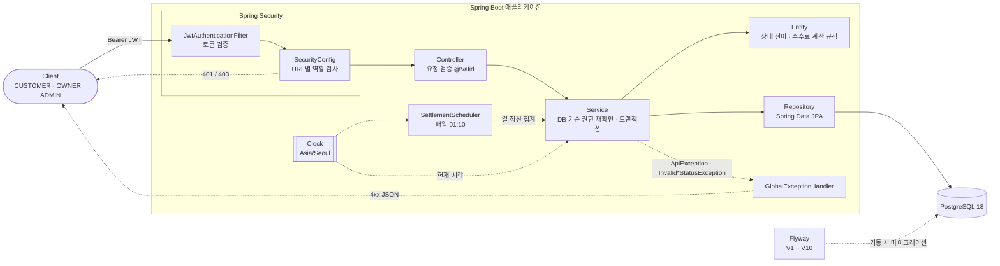
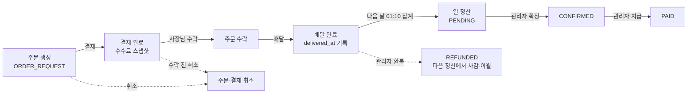
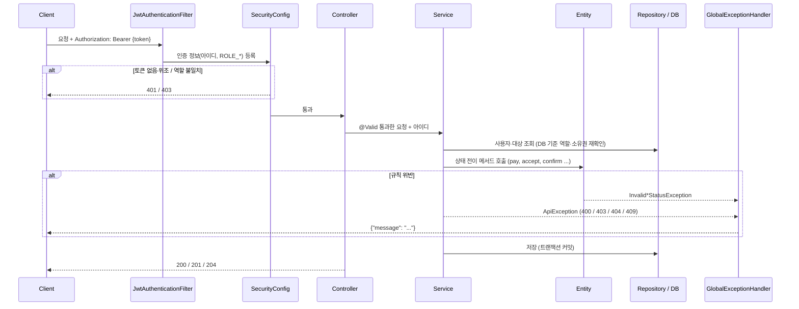

# 프로젝트 구조

[← README](../README.md)

## 아키텍처



- 스키마는 Flyway가 만들고 Hibernate는 `ddl-auto: validate`로 검사만 함 → [데이터베이스](database.md), 테이블 관계는 [ERD](erd.md)
- 권한은 두 겹: `SecurityConfig`가 URL별 역할을, Service가 DB 기준 역할·본인 데이터 여부를 다시 확인 (토큰 발급 후 역할이 바뀌는 경우 대비)
- 현재 시각은 모두 주입된 `Clock`에서 얻음 → 테스트에서 시각을 고정해 정산 날짜 경계 검증

### 주문 → 결제 → 정산 흐름



- 상태별 규칙은 [API · 주문 상태 흐름](api.md#주문-상태-흐름), 정산·환불·이월은 [정산 기준](settlement-policy.md)

## 패키지 구조

```
src/main/java/com/sparta/springdeliverymini
├── SpringDeliveryMiniApplication.java   # 실행 진입점 (JVM 기본 시간대 Asia/Seoul 고정)
├── config
│   ├── SecurityConfig.java              # URL별 접근 권한, 401/403 응답, 비밀번호 암호화(BCrypt)
│   ├── TimeConfig.java                  # 기준 시간대(Asia/Seoul), 현재 시각용 Clock 빈
│   ├── PaymentFeeProperties.java        # 수수료율 설정(payment.fee.rate) 바인딩·검증
│   ├── SchedulingConfig.java            # @EnableScheduling (settlement.scheduler.enabled로 켜고 끔)
│   └── JpaAuditingConfig.java           # @EnableJpaAuditing, 생성·수정 시각을 Clock 기준으로 기록
├── jwt
│   ├── JwtProvider.java                 # JWT 생성·검증
│   └── JwtAuthenticationFilter.java     # 요청마다 토큰을 확인해 인증 정보 등록
├── controller
│   ├── UserController.java              # 회원가입, 로그인
│   ├── StoreController.java             # 매장 생성·조회, 매장별 주문 조회, 매장별 정산 조회, 일 정산 기록 조회
│   ├── AdminSettlementController.java   # 관리자 정산 조회·확정·지급 (/api/admin/settlements)
│   ├── AdminStoreController.java        # 관리자 매장 수수료율 설정·해제 (/api/admin/stores/{id}/fee-rate)
│   ├── MenuController.java              # 메뉴 등록·조회·수정·삭제
│   ├── OrderController.java             # 주문 생성·조회·취소·상태 변경
│   └── PaymentController.java           # 결제
├── service
│   ├── UserService.java
│   ├── StoreService.java                # 매장 생성·조회, 매장 소유권 검증(getOwnedStore)
│   ├── MenuService.java
│   ├── OrderService.java
│   ├── PaymentService.java
│   ├── SettlementService.java           # 매장별 기간 정산 조회 (소유권·기간 검증, 합산)
│   ├── SettlementAggregationService.java # 일 정산 집계 → PENDING (매장별 트랜잭션, 중복 정산 방지)
│   ├── AdminSettlementService.java      # 관리자 정산 조회·확정·지급 (관리자 확인, 행 잠금)
│   ├── AdminStoreService.java           # 관리자 매장 수수료율 설정·해제 (이후 결제부터 적용)
│   └── OwnerSettlementService.java      # 사장님 일 정산 기록 목록·상세 (지급액·이월·상태, 차감 내역)
├── scheduler
│   └── SettlementScheduler.java         # 매일 01:10 최근 N일 정산 자동 집계
├── repository
│   ├── UserRepository.java
│   ├── StoreRepository.java
│   ├── MenuRepository.java
│   ├── OrderRepository.java
│   ├── PaymentRepository.java
│   └── SettlementRepository.java
├── entity
│   ├── BaseEntity.java                  # 생성·수정 시각 자동 기록 (@MappedSuperclass)
│   ├── User.java / Role.java            # 회원, 역할(CUSTOMER / OWNER / ADMIN)
│   ├── Store.java                       # 매장 (OWNER 1 : N, 소유권 판단 isOwnedBy)
│   ├── Menu.java                        # 메뉴 (매장에 속함, Soft Delete)
│   ├── Order.java / OrderStatus.java    # 주문, 주문 상태 (항목 추가·총액 계산은 addItem, 배달완료 시각 deliveredAt)
│   ├── OrderItem.java                   # 주문 항목 (메뉴 1종 × 수량, 주문 당시 이름·단가 스냅샷)
│   ├── Payment.java / PaymentMethod.java # 결제, 결제 수단(CARD)
│   ├── PaymentFee.java                  # 수수료·정산액 계산 (원 단위 HALF_UP)
│   ├── SettlementPeriod.java            # 정산 조회 기간 규칙 (반열림 구간, 확정 시각, 최대 31일)
│   ├── SettlementTotals.java            # 정산 합계 계산 (조회·확정 공통)
│   └── Settlement.java / SettlementStatus.java # 일 정산 기록, 상태(PENDING → CONFIRMED → PAID)
├── dto                                  # 요청(Request) / 응답(Response) 객체
└── exception
    ├── ApiException.java                # 상태 코드를 담아 던지는 예외
    ├── InvalidOrderStatusException.java # 허용되지 않는 주문 상태 전이 (Order 엔티티가 던짐 → 409)
    ├── InvalidSettlementStatusException.java # 허용되지 않는 정산 상태 전이 (Settlement 엔티티가 던짐 → 409)
    └── GlobalExceptionHandler.java      # 예외를 {"message": ...} JSON 응답으로 변환

src/main/resources
├── application.yml
├── .env.example                         # DB 계정 환경변수 예시 (.env로 복사해 사용, .env는 git 제외)
└── db/migration                         # Flyway 마이그레이션 SQL (V{버전}__{설명}.sql)
```

## 계층별 역할

| 패키지 | 역할 |
|---|---|
| `controller` | HTTP 요청을 받아 `@Valid`로 요청 값을 검증하고, 토큰에서 꺼낸 아이디(`authentication.getName()`)와 함께 Service에 넘김. 결과를 상태 코드와 함께 응답 |
| `service` | 비즈니스 로직 담당. 본인 데이터인지 확인, 금액 계산 등을 검증하고 실패하면 `ApiException`을 던짐. 주문 상태 전이는 직접 판단하지 않고 `Order`의 메서드를 호출. `@Transactional`로 트랜잭션 관리. 의존성은 Lombok `@RequiredArgsConstructor`로 생성자 주입 |
| `repository` | `JpaRepository`를 상속해 DB 조회·저장. 메서드 이름으로 쿼리 생성 (예: `findAllByUserId`, `existsByOrderId`), 조건이 복잡하면 `@Query`(JPQL) 사용 (예: 정산 대상 조회 `findSettlementTargets`) |
| `entity` | DB 테이블과 1:1로 대응하는 JPA 엔티티. 상태 변경은 setter 대신 `update()`, `delete()`, `cancel()`, `pay()`, `accept()`, `complete(deliveredAt)` 같은 의미 있는 메서드로만 가능. 주문 상태 전이 규칙은 `Order` 메서드 안에서 현재 상태를 확인해 한곳에서 관리하고, 위반 시 `InvalidOrderStatusException`을 던짐. 정산 상태 전이(`Settlement.confirm()`, `markPaid()`)도 같은 방식으로 `InvalidSettlementStatusException`을 던짐. Lombok `@Getter`만 쓰고 `@Setter`는 쓰지 않음, 기본 생성자는 `@NoArgsConstructor(access = PROTECTED)`로 외부 생성 차단. 테이블이 아닌 계산 규칙(`PaymentFee`, `SettlementPeriod`, `SettlementTotals`)도 도메인 규칙이라 이 패키지에 둠 |
| `dto` | 요청·응답 전용 객체(`record`). 엔티티를 그대로 노출하지 않고 필요한 값만 주고받음 (예: 응답에 비밀번호 제외, 요청에 금액 제외) |
| `config`, `jwt` | Spring Security + JWT 인증. 1차 권한 검사(역할별 URL 접근)는 `SecurityConfig`, 본인 데이터 여부 같은 세부 검사는 Service에서 처리. 역할 제한이 있는 API는 모두 `SecurityConfig`에 규칙을 두고, Service에서도 토큰 발급 후 역할 변경에 대비해 한 번 더 확인 |
| `scheduler` | `@Scheduled` 작업. 직접 로직을 갖지 않고 Service를 호출 (예: `SettlementScheduler` → `SettlementAggregationService`) |
| `exception` | 모든 에러 응답을 `{"message": "..."}` 형태로 통일 |

## 요청 처리 흐름



## 테스트

```bash
./gradlew test   # Docker 실행 중이어야 함 (로컬 DB·DB 환경변수 불필요)
```

| 종류 | 대상 | DB |
|---|---|---|
| 단위 테스트 | `OrderTest`(상태 전이, 항목 추가·총액 합산), `PaymentFeeTest`(수수료 계산·반올림), `PaymentFeePropertiesTest`(수수료율 설정 검증), `StoreTest`(소유권 판단, 매장 수수료율·공통 수수료율 fallback), `SettlementPeriodTest`(정산 기간·확정 시각), `SettlementTest`(정산 집계·합계, PENDING → CONFIRMED → PAID 전이·중복 지급 거부), `OrderServiceTest`, `MenuServiceTest`, `StoreServiceTest`, `PaymentServiceTest`, `SettlementServiceTest`, `SettlementAggregationServiceTest`(집계·중복 건너뜀·오류 격리), `SettlementSchedulerTest`(집계 날짜 선택), `AdminSettlementServiceTest`(관리자 확인, 확정·지급 시각 기록, 잘못된 전이), `UserServiceTest`(ADMIN 가입 거부), `AdminStoreServiceTest`(관리자 확인, 매장 404, 수수료율 설정·해제), `OwnerSettlementServiceTest`(권한, 기간 400, 상태 필터, 다른 매장 정산 404, 이월 차감 전) | 없음 (Mockito) |
| 웹 계층 테스트 | `OrderCancelSecurityTest` (`@WebMvcTest`, 401/403), `AmountInputRangeTest`(가격·수량 범위 초과 400), `StoreSecurityTest`(매장·정산·일 정산 기록 API 401/403, 조회 파라미터 400), `AdminSettlementSecurityTest`(관리자 API 401, CUSTOMER·OWNER 403, 잘못된 전이 409), `AdminStoreSecurityTest`(수수료율 API 401/403, 잘못된 수수료율 400) | 없음 |
| 통합 테스트 | `SpringDeliveryMiniApplicationTests`, `PaymentConcurrencyIntegrationTest`(동시 결제 시 1건만 저장), `TimeZoneIntegrationTest`, `AmountMigrationTest`(기존 데이터가 있는 DB에 V3 적용), `StoreMigrationTest`(기존 메뉴·주문을 매장으로 백필하는 V4 적용), `OrderItemMigrationTest`(기존 주문을 주문 항목으로 백필하는 V5 적용), `DeliveredAtMigrationTest`(배달완료 시각을 백필하는 V6 적용), `StoreOrderIntegrationTest`(매장 → 메뉴 → 주문 흐름, 여러 메뉴 주문, 매장별 조회·소유권), `SettlementIntegrationTest`(배달완료 → 정산 조회, 날짜 경계), `SettlementAggregationIntegrationTest`(스케줄러 집계, 반복·동시 실행 시 중복 방지, DB 제약, cron 등록), `AdminSettlementIntegrationTest`(집계 → 확정 → 지급, 잘못된 전이, 동시 지급 시 1번만 성공), `SettlementStatusMigrationTest`(V7 정산 데이터가 있는 DB에 V8 적용), `StoreFeeRateMigrationTest`(V9 데이터가 있는 DB에 V10 적용, CHECK 제약), `OwnerSettlementIntegrationTest`(일 정산 기록 = 관리자 정산, 늦은 환불의 차감 정산, 이월 연결, 판매 내역 합계), `StoreFeeRateIntegrationTest`(매장 수수료율 결제 스냅샷, 수수료율 혼합 정산, 확정·지급 정산 불변, 환불 차감 기준) | Testcontainers PostgreSQL |

- 통합 테스트는 `@Import(TestcontainersConfiguration.class)`를 붙이면 PostgreSQL 18 컨테이너가 뜨고 `@ServiceConnection`으로 자동 연결됨
- 스키마는 Flyway가 생성하므로 마이그레이션 SQL과 `ddl-auto: validate`도 함께 검증됨
- 같은 설정을 쓰는 테스트 클래스끼리는 컨테이너 1개를 공유하고, 테스트가 끝나면 컨테이너는 자동 삭제됨
