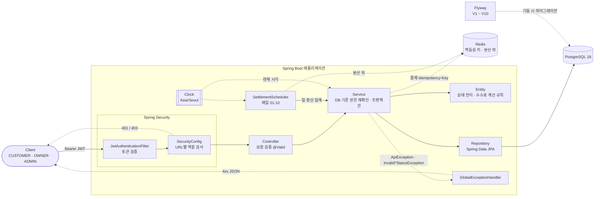
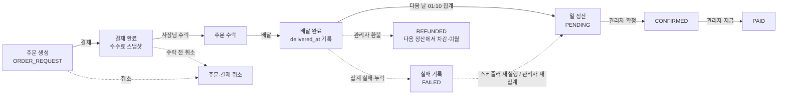
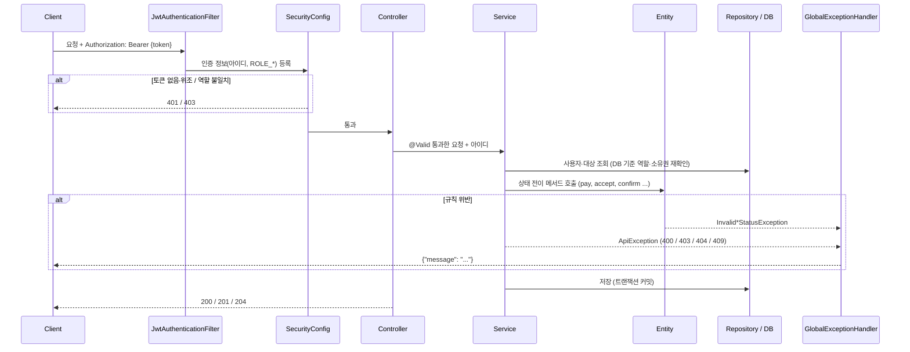

# 프로젝트 구조

[← README](../README.md)

## 아키텍처



- 스키마는 Flyway가 만들고 Hibernate는 `ddl-auto: validate`로 검사만 함 → [데이터베이스](database.md), 테이블 관계는 [ERD](erd.md)
- 권한은 두 겹: `SecurityConfig`가 URL별 역할을, Service가 DB 기준 역할·본인 데이터 여부를 다시 확인 (토큰 발급 후 역할이 바뀌는 경우 대비)
- 현재 시각은 모두 주입된 `Clock`에서 얻음 → 테스트에서 시각을 고정해 정산 날짜 경계 검증

### 주문 → 결제 → 정산 흐름



- 집계·확정·지급마다 처리자와 시각이 상태 변경 이력으로 남음 ([정산 기준 10장](settlement-policy.md#10-감사-이력과-누락실패분-재집계-39))

- 상태별 규칙은 [API · 주문 상태 흐름](api.md#주문-상태-흐름), 정산·환불·이월은 [정산 기준](settlement-policy.md)

## 패키지 구조

```
src/main/java/com/sparta/springdeliverymini
├── SpringDeliveryMiniApplication.java   # 실행 진입점 (JVM 기본 시간대 Asia/Seoul 고정)
├── config
│   ├── SecurityConfig.java              # URL별 접근 권한, 401/403 응답, 비밀번호 암호화(BCrypt)
│   ├── TimeConfig.java                  # 기준 시간대(Asia/Seoul), 현재 시각용 Clock 빈
│   ├── PaymentFeeProperties.java        # 수수료율 설정(payment.fee.rate) 바인딩·검증
│   ├── PaymentIdempotencyProperties.java # 결제 멱등성 기록 TTL(payment.idempotency.*) 바인딩·검증 (#41)
│   ├── SchedulingConfig.java            # @EnableScheduling (settlement.scheduler.enabled로 켜고 끔)
│   ├── JpaAuditingConfig.java           # @EnableJpaAuditing, 생성·수정 시각을 Clock 기준으로 기록
│   └── OpenApiConfig.java               # springdoc 문서 정보, JWT(Bearer) 인증 방식
├── logging
│   └── TraceIdFilter.java               # 요청별 traceId 생성·전달(MDC, X-Trace-Id 헤더), 요청 결과 로그
├── jwt
│   ├── JwtProvider.java                 # JWT 생성·검증
│   └── JwtAuthenticationFilter.java     # 요청마다 토큰을 확인해 인증 정보 등록
├── controller
│   ├── UserController.java              # 회원가입, 로그인
│   ├── StoreController.java             # 매장 생성·조회, 매장별 주문 조회, 매장별 정산 조회, 일 정산 기록 조회
│   ├── AdminSettlementController.java   # 관리자 정산 조회·확정·지급·이력·재집계·실패 기록 (/api/admin/settlements)
│   ├── AdminStoreController.java        # 관리자 매장 수수료율 설정·해제 (/api/admin/stores/{id}/fee-rate)
│   ├── MenuController.java              # 메뉴 등록·조회·수정·삭제
│   ├── OrderController.java             # 주문 생성·조회·취소·상태 변경
│   ├── PaymentController.java           # 결제 (선택 헤더 Idempotency-Key, 재전송 시 Idempotent-Replayed)
│   └── SliceResponse.java               # 목록 페이지 응답: 본문은 배열, 페이지 정보는 X-Page·X-Size·X-Has-Next 헤더 (#40)
├── service
│   ├── UserService.java
│   ├── StoreService.java                # 매장 생성·조회, 매장 소유권 검증(getOwnedStore)
│   ├── MenuService.java
│   ├── OrderService.java
│   ├── PaymentService.java
│   ├── PaymentIdempotencyService.java   # 결제 멱등성 — Redis 처리 중·완료 기록, 재전송·422·409·503 (#41)
│   ├── SettlementService.java           # 매장별 기간 정산 조회 (소유권·기간 검증, 합산)
│   ├── SettlementAggregationService.java # 일 정산 집계 → PENDING (매장별 트랜잭션, 중복 정산 방지, 실패 기록, 수동 재집계)
│   ├── AdminSettlementService.java      # 관리자 정산 조회·확정·지급 (관리자 확인, 행 잠금, 처리자 이력 기록), 재집계 요청
│   ├── AdminStoreService.java           # 관리자 매장 수수료율 설정·해제 (이후 결제부터 적용)
│   └── OwnerSettlementService.java      # 사장님 일 정산 기록 목록·상세 (지급액·이월·상태, 차감 내역)
├── scheduler
│   └── SettlementScheduler.java         # 매일 01:10 최근 N일 정산 자동 집계 (분산 락을 잡은 인스턴스만)
├── lock
│   ├── DistributedLock.java             # 인스턴스 간 실행 락 인터페이스 (#41)
│   ├── RedisDistributedLock.java        # Redis 구현 — SET NX PX 획득, token 확인 후 해제(Lua), 최소 유지 시간
│   └── LockUnavailableException.java    # Redis 장애로 락 상태를 알 수 없음 → 작업 미실행
├── repository
│   ├── UserRepository.java
│   ├── StoreRepository.java
│   ├── MenuRepository.java
│   ├── OrderRepository.java
│   ├── PaymentRepository.java
│   ├── SettlementRepository.java
│   ├── SettlementStatusHistoryRepository.java       # 정산 상태 변경 이력 (처리자 함께 조회)
│   └── SettlementAggregationFailureRepository.java  # 정산 집계 실패 기록
├── entity
│   ├── BaseEntity.java                  # 생성·수정 시각 자동 기록 (@MappedSuperclass)
│   ├── User.java / Role.java            # 회원, 역할(CUSTOMER / OWNER / ADMIN)
│   ├── Store.java                       # 매장 (OWNER 1 : N, 소유권 판단 isOwnedBy)
│   ├── Menu.java                        # 메뉴 (매장에 속함, Soft Delete)
│   ├── Order.java / OrderStatus.java    # 주문, 주문 상태 (항목 추가·총액 계산은 addItem, 배달완료 시각 deliveredAt)
│   ├── OrderItem.java                   # 주문 항목 (메뉴 1종 × 수량, 주문 당시 이름·단가 스냅샷)
│   ├── Payment.java / PaymentMethod.java # 결제, 결제 수단(CARD)
│   ├── PaymentFee.java                  # 수수료·정산액 계산 (원 단위 HALF_UP)
│   ├── SettlementPeriod.java            # 정산 조회 기간 규칙 (반열림 구간, 확정 시각, 최대 31일)
│   ├── SettlementTotals.java            # 정산 합계 계산 (조회·확정 공통)
│   ├── Settlement.java / SettlementStatus.java # 일 정산 기록, 상태(PENDING → CONFIRMED → PAID)
│   ├── SettlementStatusHistory.java     # 정산 상태 변경 이력 — 처리자·시각 (INSERT 전용)
│   └── SettlementAggregationFailure.java / SettlementAggregationFailureStatus.java # 집계 실패 기록, 상태(FAILED → RESOLVED)
├── dto                                  # 요청(Request) / 응답(Response) 객체, PageQuery(목록 page·size 검증, id 오름차순 고정)
└── exception
    ├── ApiException.java                # 상태 코드를 담아 던지는 예외
    ├── InvalidOrderStatusException.java # 허용되지 않는 주문 상태 전이 (Order 엔티티가 던짐 → 409)
    ├── InvalidSettlementStatusException.java # 허용되지 않는 정산 상태 전이 (Settlement 엔티티가 던짐 → 409)
    ├── ApiErrorResponse.java            # 공통 에러 응답 {status, error, message, path, traceId}
    └── GlobalExceptionHandler.java      # 예외를 ApiErrorResponse로 변환, 4xx WARN / 5xx ERROR(스택 트레이스) 로그

src/main/resources
├── application.yml                      # 공통 설정 (기본 프로필 local, DB 계정·JWT 키는 환경변수, Redis 주소·타임아웃, 멱등성 TTL·스케줄러 락, 로그 traceId, Actuator health만(Redis 헬스체크 제외)·springdoc 비활성)
├── application-local.yml                # local: localhost DB, 루트 .env 읽기, SQL 로그, prometheus·Swagger UI 노출
├── application-dev.yml                  # dev: docker-compose 실행 (DB_URL, REDIS_HOST), Actuator 관리 포트 8081, Swagger UI
└── db/migration                         # Flyway 마이그레이션 SQL (V{버전}__{설명}.sql)
```

## 계층별 역할

| 패키지 | 역할 |
|---|---|
| `controller` | HTTP 요청을 받아 `@Valid`로 요청 값을 검증하고, 토큰에서 꺼낸 아이디(`authentication.getName()`)와 함께 Service에 넘김. 결과를 상태 코드와 함께 응답 |
| `service` | 비즈니스 로직 담당. 본인 데이터인지 확인, 금액 계산 등을 검증하고 실패하면 `ApiException`을 던짐. 주문 상태 전이는 직접 판단하지 않고 `Order`의 메서드를 호출. `@Transactional`로 트랜잭션 관리. 의존성은 Lombok `@RequiredArgsConstructor`로 생성자 주입 |
| `repository` | `JpaRepository`를 상속해 DB 조회·저장. 메서드 이름으로 쿼리 생성 (예: `findAllByUserId`, `existsByOrderId`), 조건이 복잡하면 `@Query`(JPQL) 사용 (예: 정산 대상 조회 `findSettlementTargets`) |
| `entity` | DB 테이블과 1:1로 대응하는 JPA 엔티티. 상태 변경은 setter 대신 `update()`, `delete()`, `cancel()`, `pay()`, `accept()`, `complete(deliveredAt)` 같은 의미 있는 메서드로만 가능. 주문 상태 전이 규칙은 `Order` 메서드 안에서 현재 상태를 확인해 한곳에서 관리하고, 위반 시 `InvalidOrderStatusException`을 던짐. 정산 상태 전이(`Settlement.confirm()`, `markPaid()`)도 같은 방식으로 `InvalidSettlementStatusException`을 던짐. Lombok `@Getter`만 쓰고 `@Setter`는 쓰지 않음, 기본 생성자는 `@NoArgsConstructor(access = PROTECTED)`로 외부 생성 차단. 테이블이 아닌 계산 규칙(`PaymentFee`, `SettlementPeriod`, `SettlementTotals`)도 도메인 규칙이라 이 패키지에 둠 |
| `dto` | 요청·응답 전용 객체(`record`). 엔티티를 그대로 노출하지 않고 필요한 값만 주고받음 (예: 응답에 비밀번호 제외, 요청에 금액 제외) |
| `config`, `jwt` | Spring Security + JWT 인증. 1차 권한 검사(역할별 URL 접근)는 `SecurityConfig`, 본인 데이터 여부 같은 세부 검사는 Service에서 처리. 역할 제한이 있는 API는 모두 `SecurityConfig`에 규칙을 두고, Service에서도 토큰 발급 후 역할 변경에 대비해 한 번 더 확인 |
| `scheduler` | `@Scheduled` 작업. 직접 로직을 갖지 않고 Service를 호출 (예: `SettlementScheduler` → `SettlementAggregationService`) |
| `exception` | 모든 에러 응답을 `ApiErrorResponse`(`status`·`error`·`message`·`path`·`traceId`)로 통일. Security의 401/403도 같은 형식 |
| `lock` | 여러 인스턴스 사이의 실행 락. `DistributedLock`(인터페이스) / `RedisDistributedLock`(Redis 구현) — 스케줄러가 한 인스턴스에서만 실행되도록 사용 |
| `logging` | 관측성. `TraceIdFilter`가 Security보다 먼저 실행되어 요청마다 traceId를 MDC에 넣음 → 요청 로그·서비스 로그·예외 로그·에러 응답이 같은 traceId로 연결 |

## 관측성 (#38)

- 로그: 각 줄에 `[traceId]` 출력(`logging.pattern.correlation`). 스케줄러(`SettlementScheduler`)는 실행마다 새 traceId를 MDC에 넣고 종료 시 정리 → 한 번의 자동 집계 로그가 같은 ID로 묶임. 관리 포트(8081) 요청은 TraceIdFilter 밖이라 traceId 없음. 요청 로그는 메서드·경로·상태·소요 시간만 남김(쿼리·헤더·본문 제외), Actuator 요청은 제외
- 상태 변경 로그: 결제 완료·결제 취소·환불(`PaymentService`, `OrderService`, `AdminPaymentService`), 정산 확정·지급(`AdminSettlementService`)
  - 식별자·금액·상태 전이(`status=A->B`)만 기록하고 회원 아이디·주소 등 개인정보는 남기지 않음
  - 엔티티 상태 변경 직후(커밋 전) 기록 → 커밋이 실패하면 같은 traceId의 500 에러 로그가 이어서 남음
- DB 제약 위반 로그는 제약 조건 이름만 기록 (PostgreSQL 에러 상세에 입력값이 들어 있어서)
- 메트릭: Actuator + Micrometer Prometheus. `docker compose --profile monitoring up`이면 Prometheus가 `app:8081`을 수집하고 Grafana가 데이터 소스·대시보드(`monitoring/grafana`)를 자동 등록
- 노출 정책: 기본 설정은 health만·Swagger 비활성(운영 기준), local·dev 프로필에서만 prometheus·Swagger UI를 켬
- 운영 프로필은 배포 단계로 이월: 별도 프로필 없이 기본 설정(application.yml)을 그대로 쓰면 Swagger 비활성·Actuator health만·나머지 ADMIN이 유지됨. prometheus가 필요하면 dev처럼 비공개 관리 포트로 분리해서 노출
- Grafana: `GRAFANA_ADMIN_PASSWORD` 필수(빈 값·admin이면 컨테이너가 exit 1). compose는 비활성 프로필 서비스까지 변수를 치환해 `:?`를 쓰면 기본 up도 실패하므로 entrypoint에서 검사

## Redis (#41)

결제 멱등성 키와 스케줄러 분산 락에만 사용 (캐시로 쓰지 않음). **중복 결제·중복 정산을 막는 최종 근거는 계속 DB 제약**이고, Redis 기록이 사라지거나 장애가 나도 데이터가 틀어지지 않는 범위에서만 씀

| 키 | 값 | TTL | 사용처 |
|---|---|---|---|
| `idempotency:payment:{sha256(아이디 + 키)}` | 처리 중: `{state: PROCESSING, fingerprint, token}` | `payment.idempotency.processing-ttl` (1m) | `PaymentIdempotencyService` |
| (같은 키) | 완료: `{state: COMPLETED, fingerprint, response}` | `payment.idempotency.completed-ttl` (24h) | 〃 |
| `lock:settlement-daily-aggregation` | 실행마다 다른 token | `settlement.scheduler.lock-at-most-for` (30m), 끝나면 해제 또는 `lock-at-least-for`(5m)까지 단축 | `SettlementScheduler` |

### TTL과 만료 후 동작

| 기록 | TTL 시작 | 만료 후 같은 요청 |
|---|---|---|
| 결제 처리 중 | 요청이 처리 중 기록을 남긴 시점 (SET NX PX 1m) | 결제가 1분 안에 끝나지 않으면 완료 기록을 남기지 않음(경고 로그) → 이후 재시도는 결제를 다시 시도하고 DB 검사로 409 |
| 결제 완료 | 결제 커밋 후 완료로 바꾼 시점 (PX 24h를 새로 지정) | 새 요청으로 처리 → 이미 결제된 주문이라 409 (재결제 없음) |
| 스케줄러 락 | 락 획득 시점 (SET NX PX 30m) | 실행 시간 < 5분 → 끝나도 획득 후 5분까지 유지 / 5분 이상 → 끝나면 바로 삭제 / 30분 초과 → 실행 중 만료(종료 시 경고 로그, 해제는 token이 달라 아무것도 지우지 않음) |

- 락이 실제로 유지되는 시간 = max(실행 시간, 5분), 최대 30분. 5분은 인스턴스 간 시계 차이를 흡수하는 값 → 차이가 5분을 넘으면 늦은 인스턴스가 다시 실행할 수 있음 (정산은 DB UNIQUE로 1건 유지)
- 30분을 넘겨 락이 풀려도 cron은 하루 한 번(01:10)이라 그 사이 락을 다시 시도하는 인스턴스는 사실상 없음. 30분은 실측 근거가 없는 초기값 → 매장 수가 늘면 실행 시간을 재고 조정
- local·dev Redis는 AOF(`appendfsync everysec`) + 볼륨(`redis-data`)으로 영속화 → 재시작해도 남은 TTL 그대로 유지. 비정상 종료 시 최대 약 1초분 기록 유실 가능

### 장애 시 동작

| 상황 | 결과 | 데이터 |
|---|---|---|
| 결제 전 Redis 연결 실패·타임아웃(1초) | 결제하지 않고 503 | 변경 없음 |
| 타임아웃된 처리 중 기록(SET NX)이 Redis 회복 후 늦게 실행됨 | 주인 없는 처리 중 기록이 최대 1분 남음 → 그동안 같은 키 재시도는 409(처리 중) | 결제 없음 |
| 결제 커밋 직후 Redis 장애 (완료 기록 실패) | 첫 요청은 201 그대로. 재시도는 장애 중 503 → 회복 후 처리 중 기록이 남아 있으면 최대 1분 409(처리 중) → 그 뒤 DB 검사 409. **처음 응답은 다시 받을 수 없음** | 결제 1건 유지 |
| 결제 실패 후 기록 삭제 실패 | 원래 오류 그대로 응답, 처리 중 기록은 1분 뒤 만료 | 결제 없음 |
| 완료 기록·삭제 명령이 늦게 실행됨 | 값이 내 처리 중 기록일 때만 바꾸므로 다른 요청의 기록을 덮어쓰거나 지우지 않음 | 영향 없음 |
| Redis 재시작 | AOF로 기록·TTL 복구 (영속화가 없다면 완료 기록이 사라져 재시도는 409) | 결제 1건 유지 |
| 스케줄러 락 확인 실패 | 그날 실행 건너뜀 → 다음 날 최근 7일 재집계, 그보다 오래된 날짜는 관리자 재집계 | 정산 없음(보충 대상) |
| 타임아웃된 락 SET NX가 늦게 실행됨 | 주인 없는 락이 최대 30분 남아 그날 어느 인스턴스도 실행하지 않음 → 위와 같이 보충 | 정산 없음(보충 대상) |
| 저장된 기록을 읽을 수 없음 (호환되지 않는 응답 구조 변경 배포) | 그 키는 보관 기간(최대 24시간) 동안 500 | 변경 없음 |


- 아이디는 키에 그대로 남기지 않고 해시. `fingerprint`는 요청 본문(`orderId`·`paymentMethod`)의 SHA-256 → 같은 키에 다른 요청이면 422
- 결제 흐름: `SET NX PX`로 처리 중 기록 → `PaymentService.pay()`(트랜잭션 커밋) → 처리 중 기록이 내 것일 때만 완료로 교체(Lua). 실패하면 내 기록일 때만 삭제(Lua)
  - 완료 기록은 **커밋 뒤**에 남김 → 롤백된 결제의 응답을 재전송하는 일이 없음
- 장애 처리
  - 결제: 처리 중 기록을 못 남기면 결제하지 않고 503. 결제 후 완료 기록·실패 후 삭제가 실패하면 결제 결과는 그대로 응답하고 로그만 → 처리 중 기록은 TTL 뒤 만료, 그 뒤 재시도는 DB 검사(409)
  - 스케줄러: 락 확인이 안 되면 실행하지 않음 (다음 실행의 catch-up·관리자 재집계로 보충)
  - 명령 타임아웃 1초(`spring.data.redis.timeout`) — Lettuce 기본 60초 동안 요청이 묶이지 않도록
  - Redis 헬스체크는 끔 (`management.health.redis.enabled: false`) — 키 없는 결제·조회 등 나머지 API는 정상이므로 인스턴스 전체가 DOWN 처리되지 않도록
- 단일 Redis 노드 기준. 복제·클러스터 장애 조치(failover) 중 기록 유실은 DB 제약이 최종 방어 (Redlock은 쓰지 않음)

### 후속 개선 (이 브랜치 범위 밖)
- **Redis 장애 관측성 (별도 이슈)**: 결제 쪽 Redis 장애는 WARN 로그로만 남고 전용 메트릭이 없음(`/api/payments` 503 건수로 간접 확인), 헬스체크를 꺼서 트래픽이 없으면 장애를 알 수 없음, 락 30분 초과 경고는 실행이 끝난 뒤에만 남음 → Redis 오류·503·락 건너뜀 카운터, 알림 기준, Lettuce 메트릭 노출 확인
- **DB 기반 멱등성 기록**: 커밋 직후 Redis 장애나 TTL 만료 뒤에는 처음 응답을 다시 줄 수 없음 → 결제와 같은 트랜잭션에 멱등성 키를 저장(새 마이그레이션)하면 Redis 상태와 관계없이 재전송 가능. 결제 단건 조회 API도 함께 검토

## 요청 처리 흐름



## 테스트

```bash
./gradlew test   # Docker 실행 중이어야 함 (로컬 DB·DB 환경변수 불필요)
```

- `test` 프로필이 build.gradle에서 자동 활성화되어 `src/test/resources/application-test.yml`의 테스트 전용 JWT 키를 사용 (main jar에는 포함되지 않음)
- CI(`.github/workflows/ci.yml`)도 같은 `./gradlew build`로 전체 테스트를 실행

| 종류 | 대상 | DB |
|---|---|---|
| 단위 테스트 | `TraceIdFilterTest`(traceId 생성·전달, 잘못된 외부 값 거부, MDC 정리), `OrderTest`(상태 전이, 항목 추가·총액 합산), `PaymentFeeTest`(수수료 계산·반올림), `PaymentFeePropertiesTest`(수수료율 설정 검증), `StoreTest`(소유권 판단, 매장 수수료율·공통 수수료율 fallback), `SettlementPeriodTest`(정산 기간·확정 시각), `SettlementTest`(정산 집계·합계, PENDING → CONFIRMED → PAID 전이·중복 지급 거부), `OrderServiceTest`, `MenuServiceTest`, `StoreServiceTest`, `PaymentServiceTest`, `SettlementServiceTest`, `SettlementAuditTest`(상태 이력 생성 규칙·처리자 필수, 실패 기록 FAILED ↔ RESOLVED), `SettlementAggregationServiceTest`(집계·중복 건너뜀·오류 격리, 집계 이력 처리자, 실패 기록·해결, 매장 지정 재집계), `SettlementSchedulerTest`(집계 날짜 선택, 실행별 traceId·MDC 정리, 분산 락 미획득·Redis 장애 시 건너뜀), `AdminSettlementServiceTest`(관리자 확인, 확정·지급 시각 기록, 잘못된 전이, 상태 변경 로그, 확정·지급 이력의 처리자, 재집계 400·404·409), `UserServiceTest`(ADMIN 가입 거부), `AdminStoreServiceTest`(관리자 확인, 매장 404, 수수료율 설정·해제), `OwnerSettlementServiceTest`(권한, 기간 400, 상태 필터, 다른 매장 정산 404, 이월 차감 전) | 없음 (Mockito) |
| 웹 계층 테스트 | `ErrorResponseFormatTest`(401·403·404·405·409·500 공통 형식, 본문·헤더·로그 traceId 일치, 500 내부 메시지 숨김), `OrderCancelSecurityTest` (`@WebMvcTest`, 401/403), `AmountInputRangeTest`(가격·수량 범위 초과 400), `StoreSecurityTest`(매장·정산·일 정산 기록 API 401/403, 조회 파라미터 400, 목록 페이지 기본값·헤더·page/size 범위 400), `AdminSettlementSecurityTest`(관리자 API 401, CUSTOMER·OWNER 403, 잘못된 전이 409, 재집계·이력·실패 기록 API 권한과 처리자 파라미터 무시), `AdminStoreSecurityTest`(수수료율 API 401/403, 잘못된 수수료율 400) | 없음 |
| 통합 테스트 | `ObservabilityDefaultExposureIntegrationTest`(기본 설정: health만 공개·prometheus/Swagger 비노출·기타 Actuator ADMIN), `ObservabilityEnabledIntegrationTest`(local·dev 설정: prometheus 수집, metrics ADMIN, OpenAPI 명세·Swagger UI), `SpringDeliveryMiniApplicationTests`, `PaymentConcurrencyIntegrationTest`(동시 결제 시 1건만 저장), `TimeZoneIntegrationTest`, `AmountMigrationTest`(기존 데이터가 있는 DB에 V3 적용), `StoreMigrationTest`(기존 메뉴·주문을 매장으로 백필하는 V4 적용), `OrderItemMigrationTest`(기존 주문을 주문 항목으로 백필하는 V5 적용), `DeliveredAtMigrationTest`(배달완료 시각을 백필하는 V6 적용), `StoreOrderIntegrationTest`(매장 → 메뉴 → 주문 흐름, 여러 메뉴 주문, 매장별 조회·소유권, 목록 페이지 순서·겹침 없음, 주문 목록 쿼리 3번(N+1 없음)), `SettlementIntegrationTest`(배달완료 → 정산 조회, 날짜 경계), `SettlementAggregationIntegrationTest`(스케줄러 집계, 반복·동시 실행 시 중복 방지, DB 제약, cron 등록), `AdminSettlementIntegrationTest`(집계 → 확정 → 지급, 잘못된 전이, 동시 지급 시 1번만 성공), `SettlementStatusMigrationTest`(V7 정산 데이터가 있는 DB에 V8 적용), `StoreFeeRateMigrationTest`(V9 데이터가 있는 DB에 V10 적용, CHECK 제약), `SettlementAuditMigrationTest`(V10 데이터가 있는 DB에 V11 적용, 이력·실패 기록 제약), `OrderListIndexMigrationTest`(V11 데이터가 있는 DB에 V12 적용, 주문 목록 인덱스 생성·기존 인덱스 교체·실행 계획), `SettlementAuditRecoveryIntegrationTest`(누락·실패분 재집계와 복구, 중복·동시 재집계와 스케줄러 경합, 기존 정산 재집계 차단, 확정·지급 처리자 이력), `OwnerSettlementIntegrationTest`(일 정산 기록 = 관리자 정산, 늦은 환불의 차감 정산, 이월 연결, 판매 내역 합계), `StoreFeeRateIntegrationTest`(매장 수수료율 결제 스냅샷, 수수료율 혼합 정산, 확정·지급 정산 불변, 환불 차감 기준) | Testcontainers PostgreSQL |

- 통합 테스트는 `@Import(TestcontainersConfiguration.class)`를 붙이면 PostgreSQL 18·Redis 컨테이너가 뜨고 `@ServiceConnection`으로 자동 연결됨
- Redis 테스트 (#41): `PaymentIdempotencyIntegrationTest`(같은 키 재전송·동시 요청 1건 처리·다른 요청 422·키 없는 기존 동작·실패 후 재시도·사용자별 분리·키 형식·TTL), `PaymentIdempotencyRedisFailureTest`(연결 실패·타임아웃 503, 결제 후 Redis 실패에도 응답 유지·재실행 없음), `RedisDistributedLockTest`(획득·해제·예외·최소/최대 유지 시간·만료 후 남의 락 보호·동시 경합·장애), `SettlementSchedulerLockTest`(여러 인스턴스 동시 실행 시 1번만 집계, 늦게 깨어난 인스턴스, 실패 후 해제, Redis 장애 시 미실행)
  - 장애 재현: `RedisTestSupport`의 별도 Redis 컨테이너에 `CLIENT PAUSE`(타임아웃) / 닫힌 포트(연결 실패) — 통합 테스트용 Redis에는 영향 없음
- 스키마는 Flyway가 생성하므로 마이그레이션 SQL과 `ddl-auto: validate`도 함께 검증됨
- 같은 설정을 쓰는 테스트 클래스끼리는 컨테이너 1개를 공유하고, 테스트가 끝나면 컨테이너는 자동 삭제됨
