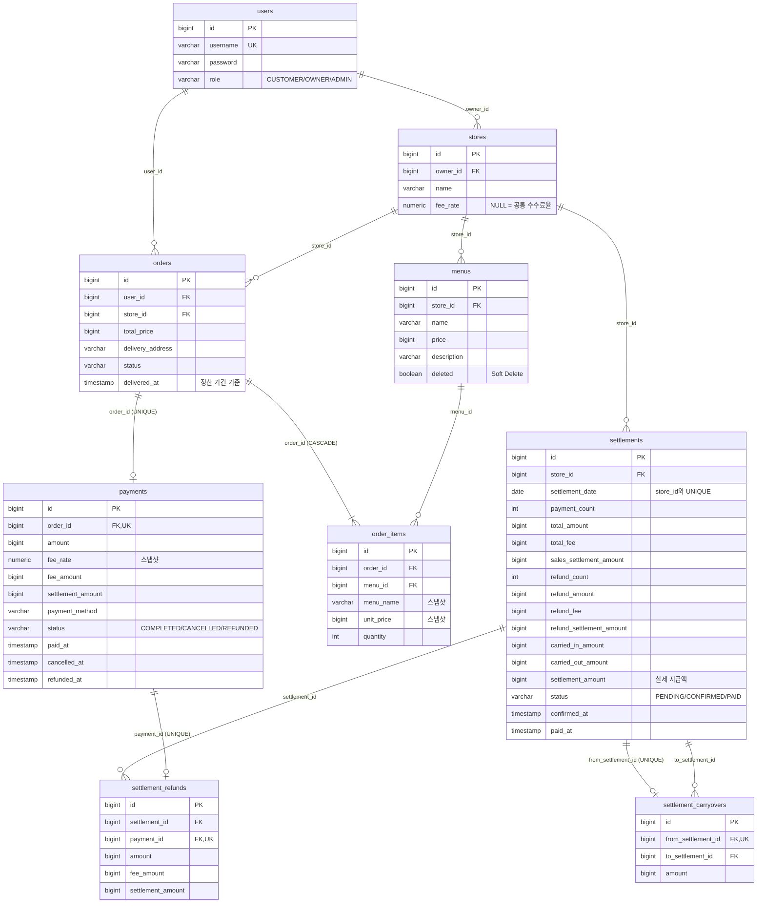

# ERD

[← README](../README.md) · [데이터베이스 상세](database.md)

V10 기준. 컬럼 상세·CHECK 제약은 [데이터베이스 · 테이블 상세](database.md#테이블-상세) 참고 (`created_at`·`updated_at`은 생략)

## 테이블 관계

| 관계 | 종류 | FK | 설명 |
|---|---|---|---|
| users ─ stores | 1 : N | `stores.owner_id` → `users.id` | OWNER 한 명이 여러 매장을 보유 |
| stores ─ menus | 1 : N | `menus.store_id` → `stores.id` | 한 매장에 여러 메뉴 |
| stores ─ orders | 1 : N | `orders.store_id` → `stores.id` | 한 매장에 여러 주문이 들어옴 (메뉴의 매장과 항상 같음) |
| users ─ orders | 1 : N | `orders.user_id` → `users.id` | CUSTOMER 한 명이 여러 주문을 생성 |
| orders ─ order_items | 1 : N | `order_items.order_id` → `orders.id` (ON DELETE CASCADE) | 한 주문에 여러 항목, 주문이 지워지면 항목도 함께 삭제 |
| menus ─ order_items | 1 : N | `order_items.menu_id` → `menus.id` | 한 메뉴가 여러 주문 항목에 담김 |
| orders ─ payments | 1 : 1 | `payments.order_id` → `orders.id` (unique) | 주문 1건당 결제는 1건만 가능 |
| stores ─ settlements | 1 : N | `settlements.store_id` → `stores.id` | 한 매장에 날짜별 정산 기록 (매장·날짜당 1건) |
| settlements ─ settlement_refunds | 1 : N | `settlement_refunds.settlement_id` → `settlements.id` | 정산 1건에서 여러 환불을 차감 |
| payments ─ settlement_refunds | 1 : 1 | `settlement_refunds.payment_id` → `payments.id` (unique) | 환불 1건은 정확히 한 정산에서만 차감 |
| settlements ─ settlement_carryovers | 1 : 1 / 1 : N | `from_settlement_id` (unique), `to_settlement_id` → `settlements.id` | 한 정산의 이월분은 한 번만, 한 정산은 여러 이월분을 받을 수 있음 |

- **OWNER가 받은 주문 조회**: `orders → stores → users(owner)`로 본인 매장에 들어온 주문만 찾음 (`findAllByStoreOwnerId`), 매장 하나는 `findAllByStoreId`
- **`orders.store_id`를 따로 두는 이유**: 메뉴를 거치지 않고 매장별 주문 조회·소유권 검증 가능. `Order.addItem`이 다른 매장의 메뉴를 거부하므로 항목 메뉴의 매장과 어긋날 수 없음
- **메뉴는 Soft Delete**: 실제로 행을 지우면 그 메뉴를 참조하는 주문 항목의 FK(`order_items.menu_id`)가 깨지므로, `deleted = true`로만 표시하고 조회에서 제외
- **중복 결제 방지**: `payments.order_id`에 unique 제약을 걸어 같은 주문의 결제가 동시에 들어와도 DB에서 한 건만 저장됨
- **중복 정산 방지**: `settlements (store_id, settlement_date)`에 unique 제약을 걸어 스케줄러가 여러 번·동시에 실행돼도 매장·날짜당 한 건만 저장됨
